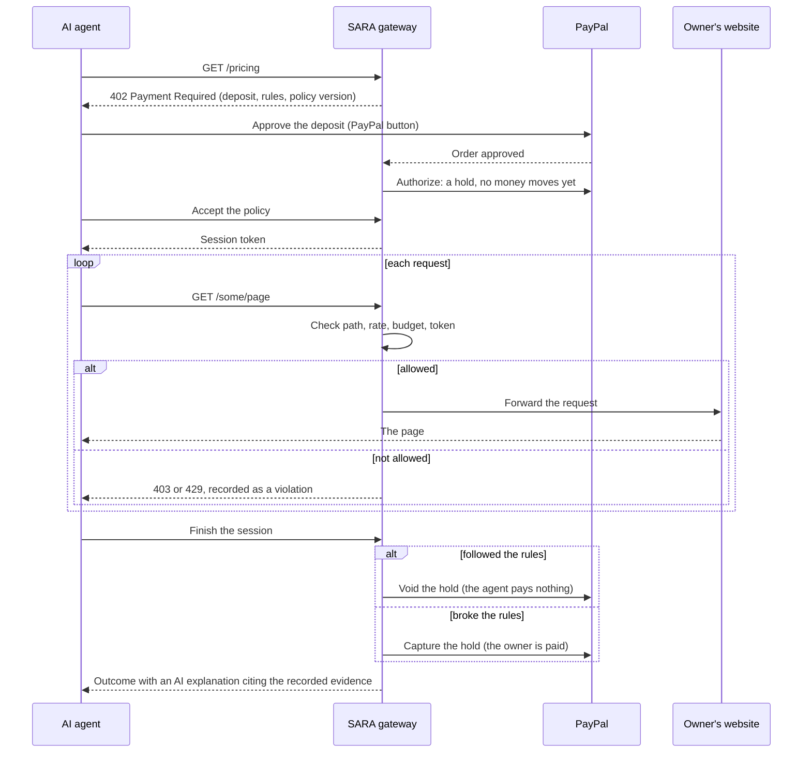

# SARA: Safe Access for Responsible Agents

**Good agents get in. Bad agents pay.**

SARA is a gateway a website owner puts in front of their site. Every AI agent that wants in pays a refundable PayPal deposit and agrees to the site's rules. An agent that follows the rules gets the deposit back. An agent that scrapes, probes private pages or floods the site loses it, and the owner is paid through PayPal. The website itself does not change.

[](https://github.com/sartech-labs/Paypal-hackathon-idea-1/actions/workflows/ci.yml)  

By [Sartech Labs](https://github.com/sartech-labs) (Safe And Responsible Technology).

- **Demo video (under 3 minutes):** https://youtu.be/uP0hEgHriYk
- **Live:** https://sara-gateway.onrender.com. The console is private; sign-in details are in our Devpost submission. The service runs on Render's free plan, so the first visit after a quiet spell can take about a minute to wake it.
- **Run it yourself:** [quick start](#run-it-yourself), no credentials needed in mock mode.
- **Full reference:** configuration, API, architecture, state machines, security and tests are in [`docs/REFERENCE.md`](docs/REFERENCE.md).

## Contents

- [The problem](#the-problem)
- [How SARA works](#how-sara-works)
- [The owner console](#the-owner-console)
- [Where PayPal is](#where-paypal-is)
- [Where the AI is](#where-the-ai-is)
- [How SARA fits with existing work](#how-sara-fits-with-existing-work)
- [Run it yourself](#run-it-yourself)
- [What is real and what is simplified](#what-is-real-and-what-is-simplified)
- [Tests](#tests)
- [AI tools used](#ai-tools-used)

## The problem

AI agents now read, compare, and shop on websites for people. Most site owners have two options: block them all and lose the good ones, or let them all in and pay for the bad ones.

| Signal | Number |
| :--- | :--- |
| One AI bot against one website ([Fastly, via The Register, Aug 2025](https://www.theregister.com/2025/08/21/ai_crawler_traffic/)) | up to **39,000 requests a minute** |
| AI bot scrapes that ignored `robots.txt` ([TollBit State of the Bots, Q2 2025](https://tollbit.com/bots/25q2)) | **13.3%**, up from 3.3% two quarters earlier |
| Automated share of all web traffic ([Imperva Bad Bot Report 2025](https://www.businesswire.com/news/home/20250415432215/en/Artificial-Intelligence-Fuels-Rise-of-Hard-to-Detect-Bots-That-Now-Make-up-More-Than-Half-of-Global-Internet-Traffic-According-to-the-2025-Imperva-Bad-Bot-Report)) | **51%**, of which bad bots **37%** |
| Wikimedia media bandwidth, driven by bots ([The Register, Apr 2025](https://www.theregister.com/2025/04/03/wikimedia_foundation_bemoans_bot_bandwidth/)) | **+50%** since January 2024 |
| Shoppers arriving at US retail sites from AI assistants ([Adobe, 2025 holiday season](https://business.adobe.com/blog/ai-driven-traffic-surges-across-industries)) | **+693%** year on year |
| US e-commerce done by AI agents by 2030 ([Morgan Stanley, Dec 2025](https://www.digitalcommerce360.com/2025/12/09/morgan-stanley-ai-agentic-shoppers-385-billion-online-sales/amp/)) | **$190-385 billion** (10-20% of online retail) |

`robots.txt` only asks. Nothing happens to an agent that ignores it. SARA puts money behind the site's rules, so following them is free and breaking them costs the agent.

## How SARA works

**For the owner, setup takes three steps:**

1. **Add your website.** SARA reads the site's own `robots.txt` and turns its `Disallow` lines into enforced rules. Domain verification and the DNS switch are shown as setup steps; this hosted instance skips them (see [what is simplified](#what-is-real-and-what-is-simplified)).
2. **Connect PayPal.** Log in with PayPal links the account that receives kept deposits.
3. **Set the deposit and rules.** The deposit amount, blocked paths, the rate limit, and the request budget per session.

**For every agent request after that:**



People are not affected: a real browser is forwarded to the website as normal. Only agent traffic is gated.

The decision to return or keep a deposit is made by deterministic code from the gateway's own records, never by a model. The AI explains the decision afterwards and must cite the audit events behind each finding.

## The owner console

| Section | What the owner sees |
| :--- | :--- |
| **Overview** | Deposits held, kept, and returned; agents let in and blocked; recent decisions; trends. Filter by website. |
| **Websites → Setup** | Add a website, connect PayPal, set the deposit and rules, and see the connection steps. |
| **Websites → Playground** | Send test agents at your own site and watch what the gateway does. Five AI agents with a goal (Polite researcher, Price scraper, Admin prober, Tricked by a page, Budget burner), four scripted attacks (reused session, forged identity, never pays, path trickery), or your own goal in plain English. The agent's deposit is approved with the PayPal button, as a real agent's would be. |
| **Agents → Activity, Violations** | Every session and request; every blocked request with the rule it broke. |
| **Money → Deposits, Earnings, Analytics** | Each deposit with its PayPal reference and the AI's "why this outcome"; kept deposits paid to your PayPal account; AG Grid and AG Studio dashboards. |

Each website keeps its own numbers, so an owner with several sites sees each one separately or all together.

## Where PayPal is

Every money movement goes through PayPal; SARA never stores card or account details.

| PayPal product | Used for |
| :--- | :--- |
| **Log in with PayPal** (OpenID Connect) | The owner connects the PayPal account that receives kept deposits |
| **JS SDK v6** (`<paypal-button>`, one-time payment session) | Approving an agent's deposit with PayPal's own button |
| **Orders v2** (`intent: AUTHORIZE`) | The deposit as a hold; the server sets the amount and verifies the order with PayPal itself |
| **Payments v2** authorizations | Void the hold for an honest agent (no money moves, no fee); capture it from a rule breaker |
| **Payments v2** refunds | The alternative capture-then-refund settlement mode, with reconciliation so a timeout never refunds twice |
| **Webhooks** | Verified with `verify-webhook-signature` and processed once each, to keep deposits in sync with PayPal |
| **PayPal MCP server** (`@paypal/mcp`) | "Verify with PayPal" compares each deposit with PayPal's own record, field by field; the read-only PayPal assistant answers questions about deposits, refunds, and disputes |
| **Vault, Subscriptions v1, itemized Orders** | Agents can save a payment method, subscribe, or buy items through the same gateway (see the reference) |

**Why a hold and not a charge.** In authorization mode (`DEPOSIT_SETTLEMENT=authorization`, the production setting) an honest agent's deposit is only ever a hold that is voided, so no money moves and no PayPal fee is charged. Only a rule breaker's hold is captured. PayPal holds last up to 29 days; SARA sessions last at most 24 hours.

The full list of PayPal endpoints called is in [`docs/REFERENCE.md`](docs/REFERENCE.md#api-reference) and `server/services/payment_service.py`.

## Where the AI is

| Feature | What it does | Code |
| :--- | :--- | :--- |
| **Deposit explanations** | Explains in plain English why a deposit was returned or kept. Each finding must cite audit events recorded for that deposit; findings with invalid citations are dropped, and a rule-based explanation is used when no model is available. | `server/services/explainer.py` |
| **Playground agents** | Real AI agents with tool use that try to reach a goal against your site: read the 402 challenge, decide whether to pay, follow or break the rules, and report what happened. | `client/agent.py`, `client/agent_tools.py`, `server/services/playground_agent.py` |
| **Policy assistant** | Turns rules written in plain English into a validated, machine-readable policy draft. Drafts are never applied automatically. | `server/services/policy_assistant.py` |
| **PayPal assistant** | Answers questions such as "any open disputes?" using read-only tools from PayPal's MCP server; every tool call and PayPal's raw answer are shown. | `server/services/paypal_assistant.py` |

Guardrails that hold whatever the model does: money decisions come from the policy engine, not the model; page content reaches agents inside `<untrusted_page_content>` tags; session tokens never reach the model; refusals stop an agent before any tool from that turn runs. The same features run on OpenAI (Responses API, GPT-5.5) or Claude (Messages API, Claude Opus 5.5), chosen with `AI_PROVIDER`.

## How SARA fits with existing work

| | What it does | What SARA adds |
| :--- | :--- | :--- |
| [Cloudflare Pay Per Crawl](https://siliconangle.com/2025/07/01/ai-game-changer-cloudflare-lets-websites-charge-ai-developers-content-access/) | `402` with a flat price per crawl; Cloudflare is merchant of record | Prices *behaviour* with a refundable deposit and enforces the rules on every request, on PayPal |
| [TollBit](https://pressgazette.co.uk/platforms/publishers-urged-to-embrace-future-where-bot-readers-provide-majority-of-revenue/) | Bot paywall for publishers, priced per 1,000 pages | Honest agents read for free; only rule breakers pay |
| [x402](https://www.spark.money/research/x402-protocol-ai-agent-payments) | Open `402` standard paid in stablecoins | `402` on PayPal: cards and wallets, buyer protection, refunds, disputes |
| [RSL](https://rslstandard.org/press/rsl-standard) | Licensing terms declared in `robots.txt`; compliance is voluntary | The same terms, enforced by the gateway with money at stake |
| [PayPal Agent Ready](https://newsroom.paypal-corp.com/2025-10-28-PayPal-Launches-Agentic-Commerce-Services-to-Power-AI-Driven-Shopping) | PayPal merchants accept payments from AI agents | Complementary: Agent Ready lets an agent pay at checkout; SARA makes every agent follow the site's rules first. Agent Ready could be the agent's way to pay the deposit |
| Agent identity ([Visa Trusted Agent Protocol](https://hapakenya.com/2025/10/23/visa-launches-trusted-agent-protocol-to-secure-ai-driven-commerce/), [Skyfire KYAPay](https://www.businesswire.com/news/home/20251218520399/en/Skyfire-Demonstrates-Secure-Agentic-Commerce-Purchase-Using-the-KYAPay-Protocol-and-Visa-Intelligent-Commerce)) | Verify who an agent is | SARA verifies signed agents (Web Bot Auth) and turns their record into their price: a clean record halves the deposit, a kept deposit triples it |

## Run it yourself

Requires Python 3.10+. Mock mode needs no PayPal or AI credentials.

```bash
git clone https://github.com/sartech-labs/Paypal-hackathon-idea-1.git
cd Paypal-hackathon-idea-1
python3 -m venv .venv && source .venv/bin/activate
pip install -r requirements.txt
cp .env.example .env
python -m uvicorn server.main:app --host 127.0.0.1 --port 8000
```

On Windows PowerShell use `python -m venv .venv`, `.\.venv\Scripts\Activate.ps1`, and `Copy-Item .env.example .env`.

Open http://127.0.0.1:8000/. To require a sign-in, set `OWNER_EMAIL`, `OWNER_PASSWORD`, and `SESSION_SECRET` in `.env`. Add a website under **Websites → Setup**, then try the scripted attacks under **Playground**. Add `OPENAI_API_KEY` or `ANTHROPIC_API_KEY` to `.env` and restart to enable the AI agents and explanations.

**With PayPal (Sandbox):**

1. In the [PayPal Developer Dashboard](https://developer.paypal.com/), create an app under **Apps & Credentials** and put its client ID and secret in `.env` as `PAYPAL_CLIENT_ID` and `PAYPAL_CLIENT_SECRET`. Set `PAYMENT_MODE=paypal_sandbox` and `DEPOSIT_SETTLEMENT=authorization`.
2. Set `APP_PUBLIC_URL` to an address PayPal can send the browser back to (on Render it defaults to the service URL).
3. For **Log in with PayPal**, open the app's settings, turn on Log in with PayPal with the email and name permissions, and add `<APP_PUBLIC_URL>/paypal/connect/callback` as a return URL. PayPal can take a few hours to apply it.
4. Optional: point a webhook at `<APP_PUBLIC_URL>/webhooks/paypal` and set `PAYPAL_WEBHOOK_ID`.

**On Render:** `render.yaml` is a Blueprint. Choose **New > Blueprint**, select the repository, and fill in the prompted values (owner email and password, PayPal credentials, an AI key). On the free plan storage is reset on every deploy, so websites, deposits, and the PayPal connection have to be set up again afterwards. Docker and running SARA in front of a real domain (`SARA_MODE=gateway`) are covered in the [reference](docs/REFERENCE.md#configuration-reference).

## What is real and what is simplified

**Real, and run end to end against PayPal:** the 402 challenge; the PayPal hold approved with PayPal's button; enforcement of blocked paths, rate limits, and request budgets; voiding a compliant agent's hold and capturing a rule breaker's; Log in with PayPal; the AI explanation; per-website numbers in the console.

**Simplified for this hosted demo:**

- **Proving you own the domain** (a DNS TXT record or a file on the site) is shown as a skipped step. Without it anyone signed in could add any public website, so the console is private.
- **Moving the site's DNS to the gateway** is shown as a skipped step. The demo reaches each website through the gateway's own address instead.
- **Locking the website to the gateway** (so agents cannot go around it) is the owner's job at their host and is not automated.
- **Routing each owner's payouts** to their own connected account: this instance has one PayPal merchant app, which receives every kept deposit; Log in with PayPal records which account the owner connected.
- **Storage** is JSON files in one process, which suits one instance; PostgreSQL and Redis are on the roadmap.

More limitations and the roadmap are in the [reference](docs/REFERENCE.md#limitations-and-roadmap).

## Tests

```bash
python -m pytest -q
```

404 tests, all offline: PayPal, the website being protected, and the AI models are replaced by fakes, so the suite needs no credentials. CI runs it on every push. What each test file covers is listed in the [reference](docs/REFERENCE.md#testing).

## AI tools used

| Tool | Where | How |
| :--- | :--- | :--- |
| OpenAI GPT-5.5 (Responses API) | Playground agents, explanations, policy assistant, PayPal assistant | Tool use with strict schemas and structured outputs. The live hosted demo uses it. |
| Anthropic Claude Opus 5.5 (Messages API) | The same features, selected with `AI_PROVIDER` | Tool use, structured outputs, refusal handling; covered by tests with scripted fakes. |
| PayPal MCP server (`@paypal/mcp`) | "Verify with PayPal", PayPal assistant | Read-only PayPal tools (orders, refunds, transactions, disputes) over MCP. |
| AI coding assistants | Development | Used to help write and review code and docs; every feature is covered by tests. |

## License

[MIT](LICENSE)
