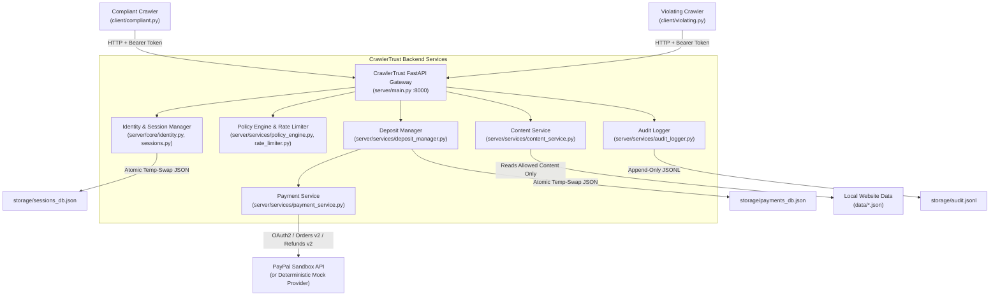
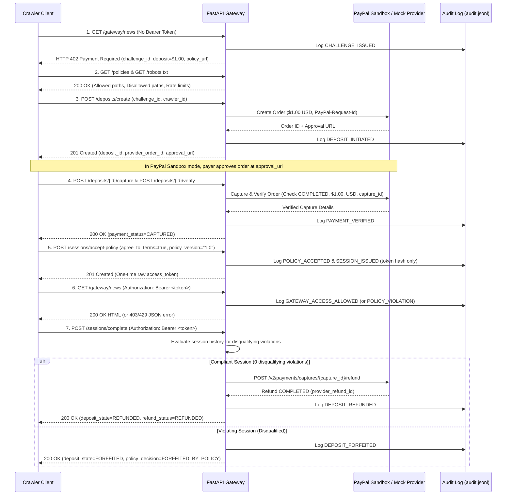
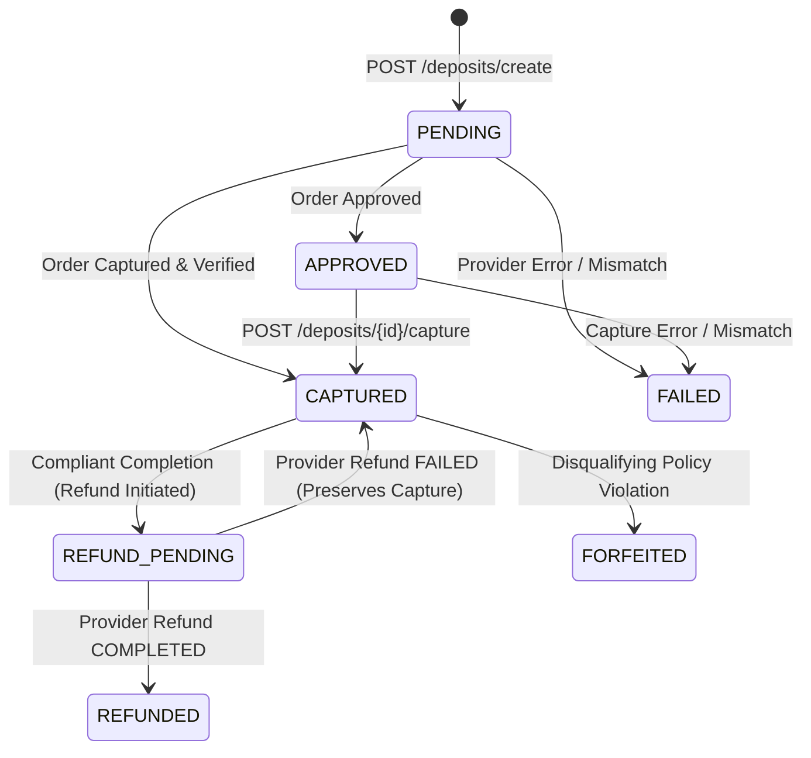
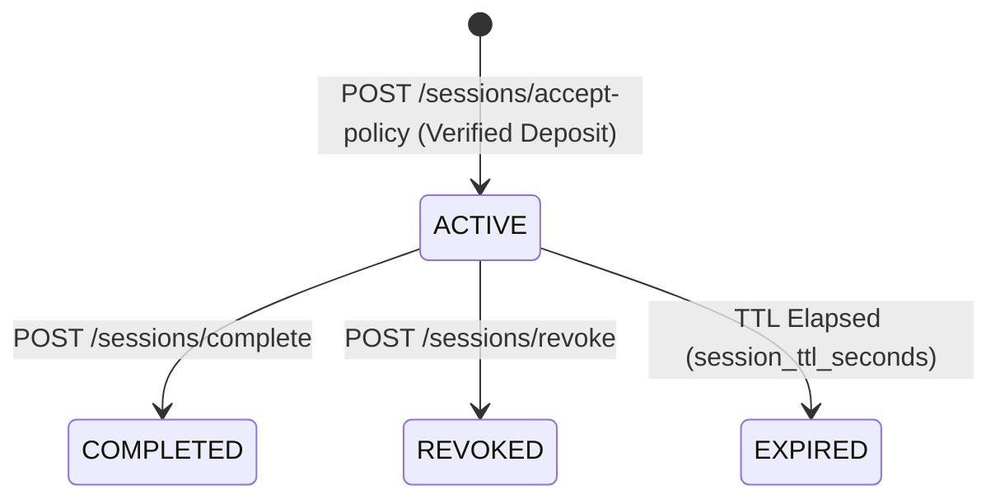

# CrawlerTrust — Deposit-Based Accountability for AI Crawlers

## 1. Project Title and Overview

**CrawlerTrust** is a lightweight, programmable trust and accountability gateway for websites interacting with AI crawlers and autonomous agents. Built with **FastAPI**, **HTTPX**, and the **PayPal Sandbox REST APIs v2** (Orders API v2 and Payments Refunds API v2), CrawlerTrust enforces website crawling policies by requiring AI crawlers to post a **refundable micro-deposit** before accessing protected content.

- **Compliant crawlers** that accept the website's policy, access only allowed paths, and respect rate limits and request budgets receive a **full automatic refund** upon completing their crawl session.
- **Violating crawlers** that ignore `robots.txt` rules, attempt to access disallowed paths (such as `/admin` or `/private/customer-data`), attempt URL-encoded path traversal, or flood the server beyond configured rate limits **forfeit their deposit** under the published policy.

> **Disclaimer**: This repository is a functional hackathon prototype. PayPal Sandbox transactions use simulated test funds and do **not** move real money. Mock payment mode (`PAYMENT_MODE=mock`) is also provided for deterministic offline development and automated testing.

---

## 2. Problem Statement and Hackathon Objective

Traditionally, websites publish a `robots.txt` file to express crawling rules (allowed paths, disallowed paths, and crawl delays). However:
1. `robots.txt` is purely advisory—nothing prevents an uncooperative scraper or autonomous AI agent from ignoring it.
2. Blanket IP blocking or aggressive CAPTCHAs block legitimate, well-behaved AI agents alongside abusive bots.
3. Website operators have no financial recourse when a crawler ignores rate limits or scrapes restricted routes.

**Hackathon Objective**: Demonstrate a working HTTP `402 Payment Required` trust layer where crawlers establish a verifiable session backed by a refundable PayPal deposit, explicitly agree to machine-readable crawling policies, and have their refund eligibility determined authoritatively from server-side audit history.

---

## 3. Why AI Crawler Accountability Matters

As autonomous agents and LLM data pipelines increasingly traverse the web programmatically, publishers face rising infrastructure costs and unauthorized scraping of restricted endpoints. Economic alignment via **refundable deposits** shifts enforcement from passive honor-system rules (`robots.txt`) to **stake-backed accountability**:
- Honest crawlers incur **$0 net cost** for compliant crawling because their deposit is refunded at session completion.
- Abusive crawlers incur a real financial penalty per violating session, making large-scale policy violations economically unattractive.

---

## 4. Solution Overview

CrawlerTrust sits in front of protected website content (`/gateway/{path}`) and enforces a six-stage lifecycle:
1. **Challenge (`HTTP 402 Payment Required`)**: Unauthenticated crawler requests receive a unique, single-use `challenge_id`, deposit requirements, and a link to `/policies`.
2. **Deposit & Payment Capture**: The crawler initiates a deposit (`/deposits/create`), completes payment via PayPal Sandbox (or labeled mock mode), and requests server-side capture and verification (`/deposits/{id}/capture`, `/deposits/{id}/verify`).
3. **Explicit Policy Acceptance**: The crawler explicitly records agreement to the current `policy_version` (`/sessions/accept-policy`).
4. **Cryptographic Session Issuance**: The server issues a high-entropy bearer token (`secrets.token_urlsafe(32)`) once and stores only its **SHA-256 hash** (`sessions_db.json`).
5. **Real-Time Policy & Rate-Limit Enforcement**: Every `/gateway/{path}` request is evaluated against session validity, path normalization, allowed/disallowed rules, session request budget, and a monotonic sliding-window rate limiter.
6. **Accountability & Refund Decision**: Upon `/sessions/complete`, the Deposit Manager inspects the authoritative session history. Compliant sessions trigger an idempotent PayPal refund (`REFUNDED`); sessions with disqualifying violations are marked `FORFEITED` (`FORFEITED_BY_POLICY`).

---

## 5. Architecture Diagram



---

## 6. Component Descriptions

| Component | File(s) | Responsibility |
| :--- | :--- | :--- |
| **Gateway API** | `server/api/gateway.py` | Single enforcement point for `/gateway` and `/gateway/{path:path}`. Issues HTTP 402 challenges and serves content only when `PolicyEngine` authorizes the request. |
| **Identity & Security** | `server/core/identity.py`, `server/core/security.py` | Generates unpredictable `challenge_id` values, validates crawler IDs, normalizes paths (blocking traversal/encoding attacks), hashes bearer tokens with SHA-256, and performs constant-time comparisons. |
| **Session Manager** | `server/core/sessions.py` | Manages session lifecycle (`ACTIVE`, `COMPLETED`, `REVOKED`, `EXPIRED`), tracks per-session violation counts, and persists snapshots atomically to `storage/sessions_db.json`. |
| **Policy Engine** | `server/services/policy_engine.py` | Pure, PayPal-independent policy evaluator returning structured `PolicyDecision` objects (`allowed`, `http_status`, `reason_code`, `violation`, `disqualifying`). |
| **Rate Limiter** | `server/services/rate_limiter.py` | Monotonic sliding-window rate limiter (`time.monotonic`) enforcing `rate_limit_requests` per `rate_limit_window_seconds` per session. |
| **Deposit Manager** | `server/services/deposit_manager.py` | Tracks orthogonal `payment_status`, `policy_decision`, and `refund_status` state machines, enforces ownership and single-use challenges, and evaluates refund eligibility. |
| **Payment Service** | `server/services/payment_service.py` | Provides `PayPalSandboxProvider` (OAuth 2.0, Orders API v2, Captures Refund API v2) and `MockPaymentProvider` behind a unified `PaymentProvider` interface. |
| **Content Service** | `server/services/content_service.py` | Loads `site_config.json`, `robots.json`, `allowed_pages.json`, and `disallowed_pages.json`. Refuses to serve content unless `PolicyDecision.allowed` is `True`. |
| **Audit Logger** | `server/services/audit_logger.py` | Writes sanitized, append-only UTC JSONL events to `storage/audit.jsonl` and computes session-scoped or global summaries. |
| **Crawler Clients** | `client/compliant.py`, `client/violating.py`, `client/common.py` | Standalone CLI scripts demonstrating compliant crawling (refunded) and policy-violating crawling (forfeited). |

---

## 7. Complete Directory Structure

```text
.
├── client/
│   ├── __init__.py
│   ├── common.py
│   ├── compliant.py
│   └── violating.py
├── server/
│   ├── __init__.py
│   ├── main.py
│   ├── config.py
│   ├── schemas.py
│   ├── dependencies.py
│   ├── core/
│   │   ├── __init__.py
│   │   ├── identity.py
│   │   ├── sessions.py
│   │   └── security.py
│   ├── services/
│   │   ├── __init__.py
│   │   ├── policy_engine.py
│   │   ├── rate_limiter.py
│   │   ├── deposit_manager.py
│   │   ├── payment_service.py
│   │   ├── audit_logger.py
│   │   └── content_service.py
│   └── api/
│       ├── __init__.py
│       ├── gateway.py
│       ├── deposits.py
│       ├── sessions.py
│       ├── policies.py
│       └── audit.py
├── data/
│   ├── site_config.json
│   ├── robots.json
│   ├── allowed_pages.json
│   └── disallowed_pages.json
├── storage/
│   ├── .gitkeep
│   └── README.md
├── tests/
│   ├── __init__.py
│   ├── conftest.py
│   ├── test_gateway.py
│   ├── test_policy_engine.py
│   ├── test_rate_limiter.py
│   ├── test_deposits.py
│   ├── test_payments.py
│   └── test_audit.py
├── .env.example
├── .gitignore
├── requirements.txt
├── pyproject.toml
├── LICENSE
└── README.md
```

---

## 8. Request Lifecycle from HTTP 402 to Refund



---

## 9. Deposit and Session State Machines

CrawlerTrust separates **inbound payment status**, **server-side policy decision**, and **outbound refund transaction status** so a policy violation is never conflated with a financial transfer and a failed refund never overwrites a captured payment record.

### A. Orthogonal Deposit Status Fields

1. **`payment_status`** (Inbound Deposit Payment):
   - `PENDING` → `APPROVED` → `CAPTURED`
   - `PENDING` / `APPROVED` → `FAILED` (if order creation, capture, or amount/currency verification fails)
   - Once `CAPTURED`, `payment_status` remains `CAPTURED` permanently.
2. **`policy_decision`** (Accountability Evaluation):
   - `UNDECIDED` → `ELIGIBLE_FOR_REFUND` (session completed with no disqualifying violations)
   - `UNDECIDED` → `FORFEITED_BY_POLICY` (session incurred disqualifying violations)
3. **`refund_status`** (Outbound Refund Operation):
   - `NOT_REQUESTED` → `REFUND_IN_PROGRESS` → `REFUNDED` (refund confirmed `COMPLETED` by provider)
   - `REFUND_IN_PROGRESS` → `REFUND_PENDING` (provider returned `PENDING`)
   - `REFUND_IN_PROGRESS` → `REFUND_FAILED` (upstream refund call failed; `payment_status=CAPTURED` and `provider_capture_id` are preserved for safe retry)
   - `NOT_REQUESTED` → `NOT_APPLICABLE_FORFEITED` (when `policy_decision == FORFEITED_BY_POLICY`)
4. **`deposit_state`** (Composite Summary State):
   - `PENDING` | `APPROVED` | `CAPTURED` | `REFUND_PENDING` | `REFUNDED` | `FORFEITED` | `FAILED`



### B. Session State Machine



---

## 10. Policy Enforcement Logic

Every authenticated request to `/gateway/{path}` is evaluated by `PolicyEngine.evaluate_request()` in strict priority order:

| Check Order | Condition | Reason Code | HTTP Status | Violation? | Disqualifying? |
| :--- | :--- | :--- | :--- | :--- | :--- |
| **1** | Missing or unknown bearer token | `INVALID_SESSION` | `401` | No | No |
| **2** | Session was explicitly revoked | `SESSION_REVOKED` | `401` | No | No |
| **3** | Session TTL has expired | `SESSION_EXPIRED` | `401` | No | No |
| **4** | Request made after `/sessions/complete` | `SESSION_ALREADY_COMPLETED` | `403` | Yes | No |
| **5** | Deposit not `CAPTURED` or already forfeited | `DEPOSIT_NOT_ACTIVE` | `402` | No | No |
| **6** | Session policy version != site policy version | `POLICY_VERSION_MISMATCH` | `403` | No | No |
| **7** | Path traversal (`..`, `%2e%2e`, `%2f`, `\`, null byte) | `INVALID_PATH` | `403` | Yes | **Yes** |
| **8** | Path matches `disallowed_paths` (specificity-aware) | `DISALLOWED_PATH` | `403` | Yes | **Yes** |
| **9** | Sliding window (`3 req / 10s`) exceeded | `RATE_LIMIT_EXCEEDED` | `429` | Yes | **Yes** (at `>= 2` violations) |
| **10** | Session budget (`10 allowed requests`) exceeded | `MAX_REQUESTS_EXCEEDED` | `429` | Yes | **Yes** (at `>= 1` violation) |
| **11** | Path not in `allowed_pages.json` | `UNKNOWN_PATH` | `404` | No | No |
| **12** | Path is in `allowed_paths` and within all limits | `ALLOWED` | `200` | No | No |

**Specificity Precedence**: When evaluating `allowed_paths` vs. `disallowed_paths`, longer (more specific) path rules always take precedence over broader rules, with `disallowed_paths` winning ties. The root path `"/"` matches only exact `"/"` and never acts as a wildcard prefix for unlisted paths.

---

## 11. Compliant Crawler Behavior (`client/compliant.py`)

`client/compliant.py` demonstrates a responsible AI crawler:
1. Sends `GET /gateway/news` without a token and receives the `402 Payment Required` challenge.
2. Fetches `GET /policies` and `GET /robots.txt` to inspect the site's allowed paths (`["/", "/news", "/news/technology", "/news/economy"]`), disallowed paths, and rate limits (`3 requests / 10s`).
3. Creates a deposit (`POST /deposits/create`), captures (`POST /deposits/{id}/capture`), and verifies it (`POST /deposits/{id}/verify`).
4. Accepts the policy (`POST /sessions/accept-policy`) and receives a bearer token.
5. Requests allowed paths while pacing its requests so it never exceeds `rate_limit_requests` per window or `max_requests_per_session`.
6. Calls `POST /sessions/complete` to finish the session and trigger refund evaluation.
7. Displays the final `REFUNDED` deposit state (`policy_decision=ELIGIBLE_FOR_REFUND`, `refund_status=REFUNDED`) and session audit summary.

---

## 12. Violating Crawler Behavior (`client/violating.py`)

`client/violating.py` demonstrates an abusive or misconfigured crawler:
1. Completes the same `402` challenge, deposit payment verification, and policy acceptance flow to obtain a valid session token.
2. Accesses an allowed path (`GET /gateway/news` -> `200 OK`).
3. Deliberately attempts to access restricted paths (`GET /gateway/admin`, `GET /gateway/private/customer-data`) and an encoded path traversal vector (`GET /gateway/%2e%2e/admin`), receiving `403 Forbidden` (`DISALLOWED_PATH` and `INVALID_PATH`).
4. Rapid-fires a burst of requests to `/gateway/news/technology` without pacing, triggering `429 Too Many Requests` (`RATE_LIMIT_EXCEEDED`).
5. Calls `POST /sessions/complete` and `POST /deposits/{id}/refund` to demand its deposit back.
6. The backend inspects the session's recorded violations, denies the refund, and marks the deposit `FORFEITED` (`policy_decision=FORFEITED_BY_POLICY`, `refund_status=NOT_APPLICABLE_FORFEITED`, while preserving `payment_status=CAPTURED`).
7. Attempts to reuse the completed session token on `GET /gateway/news` and is rejected with `403 Forbidden` (`SESSION_ALREADY_COMPLETED`).

---

## 13. PayPal Sandbox Integration Architecture

`PayPalSandboxProvider` (`server/services/payment_service.py`) integrates directly with the official PayPal REST APIs over `httpx.AsyncClient`:
1. **OAuth 2.0 Client Credentials**: `POST /v1/oauth2/token` using HTTP Basic Auth (`PAYPAL_CLIENT_ID`, `PAYPAL_CLIENT_SECRET`). Tokens are cached in memory until 60 seconds before expiry.
2. **Order Creation**: `POST /v2/checkout/orders` with `intent: "CAPTURE"`, exact server-configured `Decimal` deposit amount and currency, and a deterministic `PayPal-Request-Id` header (`ord_req_<deposit_id>`). Extracts the HATEOAS `approve` URL for payer approval.
3. **Order Capture**: `POST /v2/checkout/orders/{order_id}/capture` with `PayPal-Request-Id: cap_req_<deposit_id>`. Detects `ORDER_NOT_APPROVED` (returning HTTP `409 Conflict` with `approval_url`) and `ORDER_ALREADY_CAPTURED` (reconciling via order lookup).
4. **Authoritative Server-Side Verification**: `GET /v2/checkout/orders/{order_id}` verifies:
   - Order status is `COMPLETED` and capture status is `COMPLETED`.
   - Captured amount (`Decimal`) exactly matches `deposit.required_amount`.
   - Captured currency matches `deposit.currency`.
   - `capture_id` is present.
5. **Idempotent Capture Refund**: `POST /v2/payments/captures/{capture_id}/refund` with `PayPal-Request-Id: ref_req_<deposit_id>`. Before issuing or retrying a refund, the provider reconciles against `GET /v2/checkout/orders/{order_id}` to verify whether a refund was already created before a timeout or crash.

---

## 14. PayPal Developer Account and Sandbox Setup Instructions

To run CrawlerTrust in `PAYMENT_MODE=paypal_sandbox`:
1. Sign in to the [PayPal Developer Dashboard](https://developer.paypal.com/).
2. Navigate to **Apps & Credentials** (ensure the **Sandbox** toggle is active).
3. Click **Create App**, give it a name (e.g., `CrawlerTrust-Demo`), and select **Merchant**.
4. Copy the **Client ID** and **Secret** into your `.env` file as `PAYPAL_CLIENT_ID` and `PAYPAL_CLIENT_SECRET`.
5. Navigate to **Testing Tools > Sandbox Accounts** and note your **Personal (Buyer)** Sandbox account email and password (used to approve the checkout link in your browser during the Sandbox demo).

---

## 15. Environment Variable Reference

Copy `.env.example` to `.env`. All variables are validated at startup via `server/config.py`:

| Variable | Default | Description |
| :--- | :--- | :--- |
| `APP_ENV` | `development` | `development`, `test`, or `production` |
| `APP_HOST` | `127.0.0.1` | Bind host for Uvicorn |
| `APP_PORT` | `8000` | Bind port for Uvicorn |
| `PAYMENT_MODE` | `mock` | `mock` (simulated) or `paypal_sandbox` (live PayPal Sandbox APIs) |
| `PAYPAL_BASE_URL` | `https://api-m.sandbox.paypal.com` | PayPal Sandbox REST API base URL |
| `PAYPAL_CLIENT_ID` | *(empty)* | PayPal Sandbox OAuth2 Client ID |
| `PAYPAL_CLIENT_SECRET` | *(empty)* | PayPal Sandbox OAuth2 Client Secret |
| `PAYPAL_CURRENCY` | `USD` | 3-letter ISO currency code |
| `PAYPAL_TIMEOUT_SECONDS` | `15.0` | Timeout in seconds for outbound PayPal HTTPX requests |
| `DEPOSIT_AMOUNT` | `1.00` | Required refundable deposit amount (positive `Decimal`) |
| `SESSION_TTL_SECONDS` | `1800` | Session bearer token lifetime in seconds |
| `CHALLENGE_TTL_SECONDS` | `600` | 402 challenge expiration window in seconds |
| `MAX_REQUESTS_PER_SESSION` | `10` | Maximum allowed content requests per session |
| `RATE_LIMIT_REQUESTS` | `3` | Maximum requests allowed per sliding window |
| `RATE_LIMIT_WINDOW_SECONDS` | `10` | Sliding window duration in seconds |
| `AUDIT_LOG_PATH` | `storage/audit.jsonl` | Path to append-only JSONL audit event file |
| `PAYMENTS_DB_PATH` | `storage/payments_db.json` | Path to atomic deposit/challenge snapshot file |
| `SESSIONS_DB_PATH` | `storage/sessions_db.json` | Path to atomic session snapshot file |
| `ADMIN_API_TOKEN` | *(empty)* | Optional secret token for global `/audit/*` and admin revocation via `X-Admin-Token` (required when `APP_ENV=production`) |
| `LOG_LEVEL` | `INFO` | Python operational logging level |

---

## 16. Local Installation Instructions (Windows PowerShell & Linux/macOS)

### Windows PowerShell

```powershell
cd c:\Users\vinee\Documents\paypal-idea1\Paypal-hackathon-idea-1
Copy-Item .env.example .env
```

### Linux / macOS

```bash
cd /path/to/Paypal-hackathon-idea-1
cp .env.example .env
```

---

## 17. Virtual Environment Creation and Dependency Installation

### Windows PowerShell

```powershell
python -m venv .venv
.\.venv\Scripts\Activate.ps1
pip install -r requirements.txt
```

### Linux / macOS

```bash
python3 -m venv .venv
source .venv/bin/activate
pip install -r requirements.txt
```

---

## 18. Server Startup Command

Run the FastAPI gateway in **Terminal 1** from the repository root:

```powershell
python -m uvicorn server.main:app --host 127.0.0.1 --port 8000
```

Verify the server is healthy:

```powershell
curl http://127.0.0.1:8000/health
```

---

## 19. Instructions for Running Each Crawler in Separate Terminals

With the FastAPI server running in **Terminal 1**, open **Terminal 2** in the repository root (with `.venv` activated):

### Run Client A (Compliant Crawler)

```powershell
python -m client.compliant --base-url http://127.0.0.1:8000
```

### Run Client B (Violating Crawler)

```powershell
python -m client.violating --base-url http://127.0.0.1:8000
```

Optional CLI flags supported by both scripts:
- `--crawler-id crawler-custom-01`: Specify an explicit crawler identifier.
- `--max-requests 4`: Override the number of content requests issued.
- `--payment-mode mock` (or `paypal_sandbox`): Assert that the server is running in the expected payment mode.
- `--non-interactive`: Skip the interactive browser approval prompt in Sandbox mode.

---

## 20. Mock-Payment Demonstration

By default, `.env.example` sets `PAYMENT_MODE=mock`. In mock mode:
- Every deposit response and audit record explicitly sets `"payment_mode": "mock"` and `"simulated": true`.
- Mock mode never claims to be a real PayPal transaction, while exercising the exact same state machines, challenge binding, SHA-256 token hashing, policy engine, sliding-window rate limiter, and refund/forfeiture rules as Sandbox mode.

---

## 21. Real PayPal Sandbox Checkout and Refund Demonstration

PayPal's standard Orders API v2 creates checkout orders in `CREATED` status that require **payer approval** before capture (unless the merchant has a pre-negotiated enterprise reference transaction / vaulted payment agreement). CrawlerTrust implements the standard Sandbox flow transparently:

1. In `.env`, set:
   ```dotenv
   PAYMENT_MODE=paypal_sandbox
   PAYPAL_CLIENT_ID=your_sandbox_client_id
   PAYPAL_CLIENT_SECRET=your_sandbox_client_secret
   ```
2. Restart the FastAPI server in **Terminal 1**.
3. Run `python -m client.compliant --base-url http://127.0.0.1:8000` in **Terminal 2**.
4. When `/deposits/create` returns the PayPal Sandbox `approval_url` (`https://www.sandbox.paypal.com/checkoutnow?token=...`), the CLI prints the URL and pauses:
   - Open the `approval_url` in your browser.
   - Log in with your PayPal Sandbox Personal (Buyer) account and click **Complete Purchase / Approve**.
   - Return to **Terminal 2** and press **Enter**.
5. The CLI calls `/deposits/{deposit_id}/capture` and `/deposits/{deposit_id}/verify`. The backend captures the funds via PayPal Orders API v2, verifies the exact `1.00 USD` capture server-side, issues the session token, completes the compliant crawl, and executes a real Sandbox refund via `POST /v2/payments/captures/{capture_id}/refund`.

---

## 22. Example API Requests and Responses

### A. Initial Unauthenticated Request (`GET /gateway/news` → `HTTP 402`)

**Request:**
```http
GET /gateway/news HTTP/1.1
Host: 127.0.0.1:8000
X-Crawler-Id: crawler-demo-01
```

**Response (`402 Payment Required`):**
```json
{
  "error": "payment_required",
  "challenge_id": "chg_9c4e7f1b8a204d3c9f0123456789abcd",
  "crawler_id": "crawler-demo-01",
  "site_id": "demo-news-site",
  "policy_version": "1.0",
  "deposit": {
    "amount": "1.00",
    "currency": "USD",
    "refundable": true
  },
  "rules_summary": {
    "allowed_paths": ["/", "/news", "/news/technology", "/news/economy"],
    "disallowed_paths": ["/admin", "/private/customer-data", "/internal/reports"],
    "max_requests_per_session": 10,
    "rate_limit_requests": 3,
    "rate_limit_window_seconds": 10.0,
    "session_ttl_seconds": 1800
  },
  "policy_url": "/policies",
  "payment_url": "/deposits/create",
  "session_url": "/sessions/accept-policy",
  "expires_at": "2026-10-29T06:15:00+00:00",
  "notice": "Payment alone does not grant unrestricted access. You must verify the deposit, explicitly accept the current crawling policy version, and comply with all path and rate-limit rules to remain eligible for a deposit refund.",
  "message": "Complete the deposit and accept the crawling policy."
}
```

### B. Disallowed Path Rejection (`GET /gateway/admin` → `HTTP 403`)

```json
{
  "error": "disallowed_path",
  "allowed": false,
  "reason_code": "DISALLOWED_PATH",
  "reason": "Access to path '/admin' is prohibited by crawling policy.",
  "violation": true,
  "disqualifying": true,
  "session_disqualified": true,
  "policy_version": "1.0",
  "path": "/admin",
  "remaining_session_budget": 9,
  "remaining_window_requests": 2,
  "retry_after_seconds": 0.0
}
```

### C. Rate Limit Rejection (`HTTP 429 Too Many Requests`)

```json
{
  "error": "rate_limit_exceeded",
  "allowed": false,
  "reason_code": "RATE_LIMIT_EXCEEDED",
  "reason": "Rate limit of 3 requests per 10s window exceeded.",
  "violation": true,
  "disqualifying": true,
  "session_disqualified": true,
  "policy_version": "1.0",
  "path": "/news/technology",
  "remaining_session_budget": 7,
  "remaining_window_requests": 0,
  "retry_after_seconds": 8.42
}
```

---

## 23. Swagger UI Usage

When the FastAPI server is running, interactive OpenAPI documentation is available at:
- **Swagger UI**: `http://127.0.0.1:8000/docs`
- **ReDoc**: `http://127.0.0.1:8000/redoc`

All endpoints, request bodies, response schemas, and status codes (`200`, `201`, `400`, `401`, `402`, `403`, `404`, `409`, `429`, `502`, `504`) are documented.

---

## 24. Automated Testing Commands

Run the full automated test suite (requires no live network access or PayPal credentials):

```powershell
pytest -v
```

The test suite (`tests/`) verifies:
- `test_gateway.py`: 402 challenges, allowed/disallowed/unknown paths, URL-encoded path traversal (`%2e%2e`, `%252e`, `%2f`, `%5c`), rate limiting, and session revocation.
- `test_policy_engine.py`: Rule specificity precedence, session budgets, and policy version checks.
- `test_rate_limiter.py`: Monotonic sliding window calculation and recovery with a deterministic `FakeClock`.
- `test_deposits.py`: Single-use challenges, challenge expiration, cross-crawler ownership isolation, concurrent completion idempotency, and separated `payment_status` / `policy_decision` / `refund_status` outcomes.
- `test_payments.py`: Mocked `PayPalSandboxProvider` OAuth2, order creation, buyer approval handling (`409 Conflict`), amount/currency mismatch rejection (`402`), upstream timeouts (`504`), and failed/pending refund preservation.
- `test_audit.py`: Append-only JSONL logging, token/secret scrubbing, session-scoped vs. admin-scoped authorization, server restart recovery, and corrupted JSON detection.

---

## 25. Audit Log Inspection

Audit events are written as one JSON object per line to `storage/audit.jsonl`.

Inspect the log via PowerShell:
```powershell
Get-Content storage/audit.jsonl | Select-Object -Last 10
```

Or query via the API:
- **Session-scoped** (using a crawler's own `Authorization: Bearer <token>`):
  ```powershell
  curl -H "Authorization: Bearer <crawler_token>" http://127.0.0.1:8000/audit/summary
  ```
- **Global Admin scope** (when `ADMIN_API_TOKEN` is set in `.env`):
  ```powershell
  curl -H "X-Admin-Token: <your_admin_api_token>" http://127.0.0.1:8000/audit/events
  ```

---

## 26. Persistence Behavior and Restart Considerations

- **Atomic Snapshots**: `storage/payments_db.json` and `storage/sessions_db.json` are written to temporary `.tmp` files, flushed with `os.fsync()`, and atomically swapped via `os.replace()`.
- **Startup Recovery**: On server startup, CrawlerTrust loads `audit.jsonl`, `payments_db.json`, and `sessions_db.json`. Any `ACTIVE` session whose `expires_at` timestamp has passed is automatically transitioned to `EXPIRED`. Revoked and completed sessions remain revoked/completed and are never resurrected.
- **Corruption Detection**: If any persistence file contains malformed JSON or invalid schema records, startup raises `PersistenceCorruptionError` immediately rather than silently resetting security state.

---

## 27. Troubleshooting Common Errors

| Symptom / HTTP Status | Cause | Resolution |
| :--- | :--- | :--- |
| `409 Conflict: payer_approval_required` on `/capture` | In `paypal_sandbox` mode, the buyer has not yet approved the order in the browser. | Open the `approval_url` returned by `/deposits/create` in a browser, log in with a PayPal Sandbox buyer account, approve the payment, and retry `/capture`. |
| `502 Bad Gateway` on `/deposits/create` | `PAYMENT_MODE=paypal_sandbox` is set without valid `PAYPAL_CLIENT_ID` / `PAYPAL_CLIENT_SECRET`. | Add valid PayPal Sandbox credentials to `.env` or set `PAYMENT_MODE=mock`. |
| `401 Unauthorized` on `/audit/summary` | Missing `Authorization: Bearer <token>` or `X-Admin-Token`. | Supply the crawler's session Bearer token or configure `ADMIN_API_TOKEN` in `.env` and pass `X-Admin-Token`. |
| `PersistenceCorruptionError` on startup | A file in `storage/` was manually edited into invalid JSON. | Fix or delete the corrupted `.json`/`.jsonl` file in `storage/` and restart. |

---

## 28. Security Considerations and Limitations

### Security Practices Implemented
- **Zero Plaintext Token Storage**: Session bearer tokens are generated with `secrets.token_urlsafe(32)` and stored exclusively as SHA-256 hex digests; authentication uses `hmac.compare_digest`.
- **Sanitized Audit Logs**: Raw bearer tokens, PayPal client secrets, and admin tokens are scrubbed before writing to `audit.jsonl`.
- **Server-Controlled Amounts & Authoritative Verification**: Clients cannot supply deposit amounts or self-certify payment status.
- **Strict Path Normalization**: Raw ASGI `raw_path` inspection blocks percent-encoded dots (`%2e%2e`), double encoding (`%252e`), encoded slashes (`%2f`), backslashes (`\`, `%5c`), and dot-segments before touching `ContentService`.
- **Isolated Disallowed Content**: `ContentService` does not load disallowed page bodies into the gateway serving map and refuses to serve content unless `PolicyDecision.allowed` is `True`.

### Prototype Limitations
1. **Bearer Token vs. Cryptographic Agent Identity**: A bearer token proves continuity of a deposit session, not real-world cryptographic identity of an AI agent (such as Web Bot Auth / HTTP Message Signatures / mTLS).
2. **Single-Process JSON Persistence**: `asyncio.Lock` and atomic file replacement protect state within a **single Uvicorn worker process**. Running multiple workers (`--workers > 1`) against local JSON files is not supported.
3. **Local Append-Only File**: `storage/audit.jsonl` is append-only at the application layer but is not cryptographically tamper-proof against a privileged OS user.

---

## 29. Production-Readiness Roadmap

To evolve CrawlerTrust from a hackathon prototype into production infrastructure:
1. **Transactional Database**: Replace `payments_db.json` and `sessions_db.json` with PostgreSQL using serializable/row-locked transactions (`SELECT ... FOR UPDATE`).
2. **Distributed Rate Limiting**: Replace in-memory deques with Redis Lua token-bucket / sliding-window counters shared across gateway nodes.
3. **Cryptographic Crawler Identity**: Combine deposit sessions with RFC 9421 HTTP Message Signatures or mutual TLS (mTLS) so credentials cannot be shared across unrelated hosts.
4. **Asynchronous Webhook & Job Reconciliation**: Process PayPal Webhooks (`PAYMENT.CAPTURE.COMPLETED`, `PAYMENT.CAPTURE.REFUNDED`) with signature verification and a durable background worker queue.
5. **Tamper-Evident Audit Log**: Anchor hash-chained audit events to an immutable log store or SIEM.
6. **Legal & Dispute Framework**: Establish clear Terms of Service governing deposit forfeiture conditions and automated dispute resolution.

---

## 30. Hackathon Demonstration Script

### Step 1 — Start the Gateway (Terminal 1)
```powershell
python -m uvicorn server.main:app --host 127.0.0.1 --port 8000
```

### Step 2 — Run Compliant Crawler (Terminal 2)
```powershell
python -m client.compliant --base-url http://127.0.0.1:8000
```
**Expected Output Highlights:**
- Receives `HTTP 402` challenge (`$1.00 USD`).
- Reads `/policies` and `/robots.txt`.
- Completes deposit creation, capture, verification, and policy acceptance.
- Crawls `/gateway/`, `/gateway/news`, and `/gateway/news/technology` with `HTTP 200`.
- Completes session and receives `deposit_state: REFUNDED` (`policy_decision: ELIGIBLE_FOR_REFUND`, `refund_status: REFUNDED`).

### Step 3 — Run Violating Crawler (Terminal 2)
```powershell
python -m client.violating --base-url http://127.0.0.1:8000
```
**Expected Output Highlights:**
- Completes onboarding and accesses `/gateway/news` (`HTTP 200`).
- Attempts `/gateway/admin`, `/gateway/private/customer-data`, and `/gateway/%2e%2e/admin` → all blocked with `HTTP 403` (`DISALLOWED_PATH` / `INVALID_PATH`, `disqualifying=True`).
- Sends rapid burst to `/gateway/news/technology` → blocked with `HTTP 429` (`RATE_LIMIT_EXCEEDED`).
- Requests completion and refund → backend denies refund and records `deposit_state: FORFEITED` (`payment_status: CAPTURED`, `policy_decision: FORFEITED_BY_POLICY`, `refund_status: NOT_APPLICABLE_FORFEITED`).
- Post-completion reuse attempt on `/gateway/news` → blocked with `HTTP 403` (`SESSION_ALREADY_COMPLETED`).

