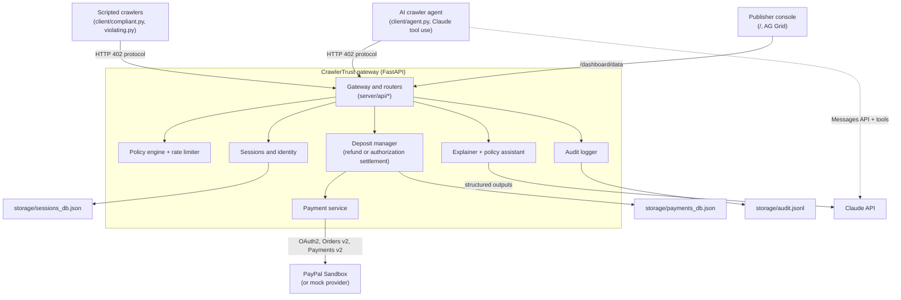
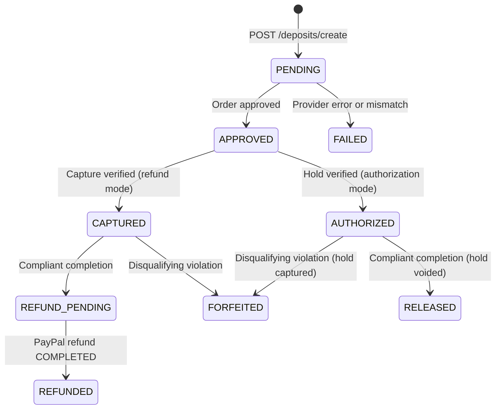
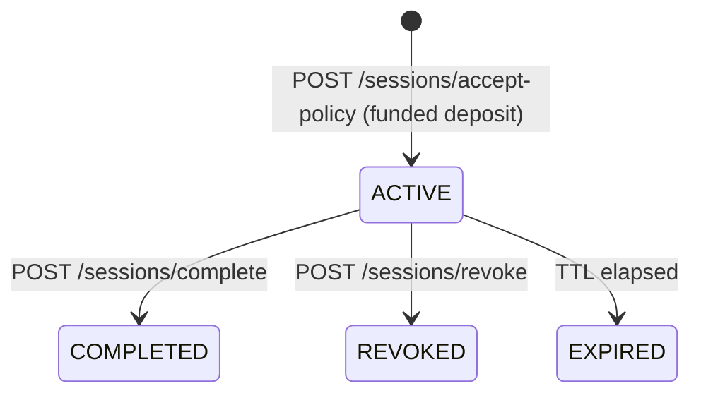

# CrawlerTrust — refundable PayPal deposits that keep AI crawlers accountable

CrawlerTrust is an HTTP `402 Payment Required` gateway that sits in front of a website. Before an AI crawler or agent can read protected pages, it posts a small **refundable deposit through PayPal** and explicitly accepts the site's machine-readable crawling policy. Crawlers that follow the policy get the deposit back. Crawlers that request forbidden paths, attempt path traversal, or flood the site lose it.

**Positioning in one line:** HTTP 402 schemes such as Cloudflare Pay Per Crawl and the x402 protocol charge crawlers for *access*. CrawlerTrust prices *misbehaviour*: well-behaved AI agents crawl at no net cost, and agents that ignore the rules pay for it.

> **Prototype notice.** Built for the PayPal AI Hackathon 2026. Payments run in mock mode or against the PayPal **Sandbox** with test funds; no real money moves.

## Contents

1. [Why this matters](#1-why-this-matters)
2. [How it works](#2-how-it-works)
3. [Where the AI is](#3-where-the-ai-is)
4. [Where PayPal is](#4-where-paypal-is)
5. [Quick start (mock mode)](#5-quick-start-mock-mode)
6. [Demo scenarios](#6-demo-scenarios)
7. [PayPal Sandbox mode](#7-paypal-sandbox-mode)
8. [Deploy (Docker and Render)](#8-deploy-docker-and-render)
9. [Configuration reference](#9-configuration-reference)
10. [API reference](#10-api-reference)
11. [Architecture](#11-architecture)
12. [Deposit and session state machines](#12-deposit-and-session-state-machines)
13. [Policy enforcement logic](#13-policy-enforcement-logic)
14. [Security and AI safety](#14-security-and-ai-safety)
15. [Testing](#15-testing)
16. [Persistence and troubleshooting](#16-persistence-and-troubleshooting)
17. [Limitations and roadmap](#17-limitations-and-roadmap)
18. [Example API responses](#18-example-api-responses)

---

## 1. Why this matters

- `robots.txt` is advisory: nothing stops an AI crawler or agent from ignoring it.
- Blanket IP blocks and CAPTCHAs also block legitimate, well-behaved agents.
- Publishers carry the infrastructure cost of scraping and have no recourse when a crawler takes restricted pages or ignores rate limits.

CrawlerTrust turns the policy into a commitment backed by money: an honest agent's deposit is returned, so compliance costs it nothing, while a violation forfeits the stake.

## 2. How it works

1. **Challenge.** A crawler without a session gets `HTTP 402` with a single-use `challenge_id`, the deposit amount, and a rules summary.
2. **Deposit.** The crawler pays through PayPal. The server sets the amount and verifies the payment itself; clients cannot self-certify.
3. **Policy acceptance.** The crawler accepts the exact `policy_version` and receives a bearer token (stored only as a SHA-256 hash).
4. **Enforced crawling.** Every `/gateway/{path}` request is checked for session validity, encoded path traversal, disallowed paths, a sliding-window rate limit, and a per-session request budget.
5. **Outcome.** On completion the gateway decides from its own records: no disqualifying violations returns the deposit; otherwise it is kept. An AI explanation, citing audit-log evidence, tells both sides why.

## 3. Where the AI is

| Feature | What it does | Code |
| :--- | :--- | :--- |
| **AI crawler agent** | Claude drives a crawler through the whole protocol with tool use: reads the 402 challenge and policy, decides whether to pay, pays through PayPal, accepts the policy, paces itself from the gateway's budget and `Retry-After` signals, and completes the session. A **compliant** persona writes a news brief and gets its deposit back; a **rogue** persona (an authorized red-team run against your own gateway) ignores the rules and loses it. | `client/agent.py`, `client/agent_tools.py` |
| **Deposit explanations** | Claude explains why a deposit was returned or kept, in plain English. Every finding must cite audit events recorded for that deposit; findings with invalid citations are dropped, and a rule-based explanation is used when AI is unavailable. | `server/services/explainer.py`, `GET /deposits/{id}/explanation` |
| **Policy assistant** | A publisher describes crawling terms in plain English; Claude drafts the machine-readable policy with structured outputs, and the server validates paths, amounts, and limits before showing the draft. Drafts are never applied automatically. | `server/services/policy_assistant.py`, `POST /policies/draft` |

Guardrails that hold whether or not the model behaves:

- **The money decision is never made by the model.** Refund or forfeiture comes from the deterministic policy engine; the AI only explains it.
- **Prompt-injection resistance.** Page content reaches the agent inside `<untrusted_page_content>` tags, and the compliant persona is instructed to ignore instructions in pages. The demo economy page carries a hidden instruction telling AI agents to fetch `/private/customer-data`; if an agent is fooled anyway, the gateway blocks the request and keeps the deposit.
- **Secrets stay out of the model.** The session bearer token is held by the tool layer and never appears in anything sent to Claude.
- **Spending cap in code.** The agent's `--max-deposit` limit is enforced before payment, not left to the model.
- **Cost guard.** Crawlers can trigger an AI explanation only once their outcome is final, and explanations are cached per deposit state. The policy assistant requires the admin token.
- **Model safety handling.** Refusals stop the agent before any tool from that turn runs; the server-side refusal fallback (`fallbacks: "default"`) is enabled by default and can be turned off with `AI_REFUSAL_FALLBACK=false`.

The model defaults to Claude Opus 5.5 and is configurable with `AI_MODEL` and `AI_EFFORT`.

## 4. Where PayPal is

PayPal REST APIs called by `PayPalSandboxProvider` (`server/services/payment_service.py`):

| API | Endpoint | Used for |
| :--- | :--- | :--- |
| OAuth 2.0 | `POST /v1/oauth2/token` | Client-credentials token, cached until 60 s before expiry |
| Orders v2 | `POST /v2/checkout/orders` | Create the deposit order (`intent` `CAPTURE` or `AUTHORIZE`), with return/cancel URLs and an idempotent `PayPal-Request-Id` |
| Orders v2 | `POST /v2/checkout/orders/{id}/capture` | Capture the deposit (refund settlement) |
| Orders v2 | `POST /v2/checkout/orders/{id}/authorize` | Place a hold on the deposit (authorization settlement) |
| Orders v2 | `GET /v2/checkout/orders/{id}` | Authoritative verification of status, amount, currency, and IDs |
| Payments v2 | `POST /v2/payments/captures/{id}/refund` | Refund a compliant crawler |
| Payments v2 | `GET /v2/payments/captures/{id}`, `GET /v2/payments/refunds/{id}` | Refund preflight and reconciliation, so timeouts never cause a double refund |
| Payments v2 | `POST /v2/payments/authorizations/{id}/void` | Release a compliant crawler's hold (no funds move) |
| Payments v2 | `POST /v2/payments/authorizations/{id}/capture` | Capture a forfeited hold |
| Payments v2 | `GET /v2/payments/authorizations/{id}` | Reconcile an ambiguous void |

Two settlement modes, selected with `DEPOSIT_SETTLEMENT`:

| Mode | Compliant crawler | Violating crawler | Notes |
| :--- | :--- | :--- | :--- |
| `refund` (default) | Order captured, then refunded | Captured funds kept | Mature path with refund reconciliation and recovery |
| `authorization` | Hold voided: no funds are ever captured, nothing to refund | Hold captured | Closer to a real deposit. PayPal documents a 29-day authorization window with a 3-day honor period; sessions last at most 24 hours |

Each deposit keeps the mode it was created with, so switching modes never strands existing deposits.

## 5. Quick start (mock mode)

Requires Python 3.10+. Mock mode needs no PayPal or Anthropic credentials.

```bash
git clone https://github.com/sartech-labs/Paypal-hackathon-idea-1.git
cd Paypal-hackathon-idea-1
python3 -m venv .venv && source .venv/bin/activate
pip install -r requirements.txt
cp .env.example .env
python -m uvicorn server.main:app --host 127.0.0.1 --port 8000
```

On Windows PowerShell use `python -m venv .venv`, `.\.venv\Scripts\Activate.ps1`, and `Copy-Item .env.example .env`.

Then open **http://127.0.0.1:8000/** for the publisher console (the example `.env` enables the read-only public view), and in a second terminal run a crawler:

```bash
python -m client.compliant --base-url http://127.0.0.1:8000
```

```bash
python -m client.violating --base-url http://127.0.0.1:8000
```

To run the AI agent, add your Anthropic API key to `.env` (`ANTHROPIC_API_KEY=...`), restart the server so it can also generate AI explanations, and run:

```bash
python -m client.agent --persona compliant --base-url http://127.0.0.1:8000
```

## 6. Demo scenarios

| Scenario | Command | What you should see |
| :--- | :--- | :--- |
| Compliant AI agent | `python -m client.agent --persona compliant` | Claude reads the policy, pays, crawls `/news` sections within the rate limit, ignores the injected instruction on `/news/economy`, completes the session, and writes a brief. Deposit **returned**. |
| Rogue AI agent | `python -m client.agent --persona rogue` | Claude requests `/admin` and private paths and bursts requests. The gateway blocks each one; the deposit is **forfeited** and the explanation cites each violation. |
| Scripted crawlers (no API key) | `python -m client.compliant` / `python -m client.violating` | The same two outcomes from deterministic scripts. |
| Publisher console | Open `/` | Live KPIs, deposits, sessions, audit feed, violations chart, and the "Why this outcome" panel. Select a deposit to explain it. |
| Policy assistant | Console panel, or `POST /policies/draft` with `X-Admin-Token` | Plain-English terms become a validated policy draft with assumptions and warnings. |

Useful agent flags: `--max-deposit 1.00` (spending limit), `--effort medium`, `--model ...`, `--max-turns 25`, `--non-interactive`. A video storyboard is in [`docs/DEMO_SCRIPT.md`](docs/DEMO_SCRIPT.md).

## 7. PayPal Sandbox mode

1. Sign in to the [PayPal Developer Dashboard](https://developer.paypal.com/), open **Apps & Credentials** with **Sandbox** selected, and create a **Merchant** app.
2. Put its client ID and secret in `.env` as `PAYPAL_CLIENT_ID` and `PAYPAL_CLIENT_SECRET`, and set `PAYMENT_MODE=paypal_sandbox`.
3. Set `APP_PUBLIC_URL` to a URL the buyer's browser can reach (PayPal redirects there after approval). On Render it defaults to `RENDER_EXTERNAL_URL`.
4. Optional: set `DEPOSIT_SETTLEMENT=authorization` to use holds instead of capture-and-refund.
5. Under **Testing Tools > Sandbox Accounts**, note the **Personal (Buyer)** account used to approve the checkout.

When a crawler creates a deposit, the response includes the PayPal `approval_url`. The CLIs and the agent print it and pause; approve it in the browser with the Sandbox buyer account and continue. PayPal also redirects the browser to `GET /deposits/paypal/return`, which checks that the returned order ID matches the deposit before capturing or authorizing; the redirect itself is never treated as proof of payment.

If a refund completed at PayPal but CrawlerTrust conservatively left it pending, an administrator can call `POST /deposits/{id}/reconcile-refund` with `X-Admin-Token`. It only reads `GET /v2/payments/refunds/{refund_id}` and never submits another refund.

## 8. Deploy (Docker and Render)

**Docker:**

```bash
docker build -t crawlertrust .
```

```bash
docker run --rm -p 8000:8000 -e DASHBOARD_PUBLIC=true -e ANTHROPIC_API_KEY=your_key crawlertrust
```

The image runs as a non-root user, binds to `$PORT` (default 8000), exposes a health check on `/health`, and always runs **one** uvicorn worker, because deposits, sessions, and rate limits live in one process.

**Render:** `render.yaml` is a Blueprint for a Docker web service. In the Render dashboard choose **New > Blueprint**, select this repository, and enter the prompted secrets (`ANTHROPIC_API_KEY`, and the PayPal keys if you switch `PAYMENT_MODE` to `paypal_sandbox`). Render generates `ADMIN_API_TOKEN`; copy it from the service's environment settings to use admin features in the console. The Blueprint enables the read-only public dashboard so judges can browse it. Storage on the free plan is ephemeral and the service sleeps when idle, so open the URL a minute before a demo.

## 9. Configuration reference

Copy `.env.example` to `.env`. Settings are validated at startup (`server/config.py`).

| Variable | Default | Description |
| :--- | :--- | :--- |
| `APP_ENV` | `development` | `development`, `test`, or `production` (production requires `ADMIN_API_TOKEN`) |
| `APP_HOST` / `APP_PORT` | `127.0.0.1` / `8000` | Bind address for local runs |
| `APP_PUBLIC_URL` | `http://127.0.0.1:8000` | Public base URL for PayPal return/cancel callbacks; falls back to `RENDER_EXTERNAL_URL` |
| `PAYMENT_MODE` | `mock` | `mock` (simulated) or `paypal_sandbox` |
| `DEPOSIT_SETTLEMENT` | `refund` | `refund` (capture, then refund compliant sessions) or `authorization` (hold, then void or capture) |
| `PAYPAL_BASE_URL` | `https://api-m.sandbox.paypal.com` | PayPal REST base URL |
| `PAYPAL_CLIENT_ID` / `PAYPAL_CLIENT_SECRET` | empty | Sandbox app credentials |
| `PAYPAL_CURRENCY` | `USD` | 3-letter ISO currency |
| `PAYPAL_TIMEOUT_SECONDS` | `15.0` | Timeout for PayPal calls |
| `DEPOSIT_AMOUNT` | `0.01` | Deposit amount (positive decimal) |
| `SESSION_TTL_SECONDS` / `CHALLENGE_TTL_SECONDS` | `1800` / `600` | Session and challenge lifetimes |
| `MAX_REQUESTS_PER_SESSION` | `10` | Allowed content requests per session |
| `RATE_LIMIT_REQUESTS` / `RATE_LIMIT_WINDOW_SECONDS` | `3` / `10` | Sliding-window rate limit |
| `AUDIT_LOG_PATH`, `PAYMENTS_DB_PATH`, `SESSIONS_DB_PATH` | `storage/...` | Persistence files |
| `ADMIN_API_TOKEN` | empty | Secret for `X-Admin-Token` (global audit, admin console, policy assistant, reconciliation) |
| `DASHBOARD_PUBLIC` | `false` (`true` in `.env.example`) | Read-only console without the admin token, for demos; keep `false` in production |
| `ANTHROPIC_API_KEY` | unset | Claude credentials (the SDK also accepts `ANTHROPIC_AUTH_TOKEN` or a profile) |
| `AI_ENABLED` | `true` | Turn AI features off entirely |
| `AI_MODEL` | `claude-opus-5-5` | Claude model for explanations, the policy assistant, and the agent CLI default |
| `AI_EFFORT` | `medium` | `low`, `medium`, `high`, `xhigh`, or `max` |
| `AI_REFUSAL_FALLBACK` | `true` | Server-side refusal fallback on Claude calls |
| `AI_TIMEOUT_SECONDS` | `120` | Timeout for Claude calls |
| `LOG_LEVEL` | `INFO` | Python logging level |

## 10. API reference

Interactive docs: **`/docs`** (Swagger UI) and **`/redoc`**.

| Method | Path | Auth | Purpose |
| :--- | :--- | :--- | :--- |
| GET | `/gateway`, `/gateway/{path}` | none (402) or crawler bearer | Protected content |
| GET | `/policies`, `/robots.txt`, `/health` | none | Machine-readable policy, robots rules, health and AI status |
| POST | `/policies/draft` | admin | Policy assistant (Claude) |
| POST | `/deposits/create` | challenge proof | Create a deposit and PayPal order |
| POST | `/deposits/{id}/capture`, `/deposits/{id}/verify` | owner | Capture (or authorize) and verify |
| GET | `/deposits/paypal/return`, `/deposits/paypal/cancel` | order match | PayPal browser callbacks |
| GET | `/deposits/{id}` | owner or admin | Deposit status |
| GET | `/deposits/{id}/explanation` | owner or admin | Evidence-cited explanation (`?use_ai=false` for rule-based) |
| POST | `/deposits/{id}/refund` | owner or admin | Evaluate and settle |
| POST | `/deposits/{id}/reconcile-refund` | admin | Reconcile a pending PayPal refund |
| POST | `/sessions/accept-policy` | deposit proof | Accept the policy and get a bearer token |
| GET | `/sessions/me` | crawler bearer | Session counters and violations |
| POST | `/sessions/complete`, `/sessions/revoke` | crawler bearer (revoke: admin too) | End the session and settle |
| GET | `/audit/events`, `/audit/summary` | crawler bearer (own session) or admin | Audit log |
| GET | `/`, `/dashboard` | none | Publisher console |
| GET | `/dashboard/data`, `/dashboard/deposits/{id}/explanation` | admin, or public when `DASHBOARD_PUBLIC=true` | Console data |

## 11. Architecture



| Component | Files | Responsibility |
| :--- | :--- | :--- |
| Gateway | `server/api/gateway.py` | Issues 402 challenges and serves content only when the policy engine allows it |
| Policy engine | `server/services/policy_engine.py`, `rate_limiter.py` | Pure, payment-independent checks returning structured decisions |
| Identity and sessions | `server/core/identity.py`, `sessions.py`, `security.py` | Challenges, hashed bearer tokens, path normalization, violation counters |
| Deposit manager | `server/services/deposit_manager.py` | Orthogonal payment / decision / refund state machines, both settlement modes, reconciliation |
| Payment service | `server/services/payment_service.py` | `PayPalSandboxProvider` and `MockPaymentProvider` behind one interface |
| AI | `server/services/ai_client.py`, `explainer.py`, `policy_assistant.py` | Claude client wrapper, explanations, policy drafts |
| Dashboard | `server/api/dashboard.py`, `server/static/*` | Publisher console and its data endpoints |
| Audit logger | `server/services/audit_logger.py` | Append-only JSONL events with secret scrubbing |
| Crawlers | `client/agent.py`, `agent_tools.py`, `compliant.py`, `violating.py`, `common.py` | AI agent and scripted demo clients |

The end-to-end request sequence is also available as an exportable diagram in [`docs/lifecycle_diagram.html`](docs/lifecycle_diagram.html).

## 12. Deposit and session state machines

CrawlerTrust keeps **payment status**, **policy decision**, and **refund status** separate, so a policy violation is never confused with a money movement and a failed provider call never overwrites a confirmed payment.

- **`payment_status`:** `PENDING` → `APPROVED` → `CAPTURED` (refund mode) or `AUTHORIZED` → `VOIDED` / `CAPTURED` (authorization mode); `FAILED` on order, capture, or verification errors.
- **`policy_decision`:** `UNDECIDED` → `ELIGIBLE_FOR_REFUND` or `FORFEITED_BY_POLICY`. The decision is recorded before any provider call and never changes afterwards.
- **`refund_status`:** `NOT_REQUESTED` → `REFUND_IN_PROGRESS` → `REFUNDED` / `REFUND_PENDING` / `REFUND_FAILED`, or `NOT_APPLICABLE_FORFEITED` / `NOT_APPLICABLE_RELEASED`.
- **`deposit_state` (summary):** `PENDING`, `APPROVED`, `AUTHORIZED`, `CAPTURED`, `REFUND_PENDING`, `REFUNDED`, `RELEASED`, `FORFEITED`, `FAILED`.





Ambiguous provider outcomes (timeouts, 5xx, 409, unreadable responses) are kept pending and reconciled against PayPal's own records before anything is retried, so a refund, void, or capture is never issued twice.

## 13. Policy enforcement logic

Every authenticated request to `/gateway/{path}` is evaluated in this order:

| # | Condition | Reason code | HTTP | Violation | Disqualifying |
| :--- | :--- | :--- | :--- | :--- | :--- |
| 1 | Missing or unknown bearer token | `INVALID_SESSION` | 401 | No | No |
| 2 | Session revoked | `SESSION_REVOKED` | 401 | No | No |
| 3 | Session expired | `SESSION_EXPIRED` | 401 | No | No |
| 4 | Request after `/sessions/complete` | `SESSION_ALREADY_COMPLETED` | 403 | Yes | No |
| 5 | Deposit not funded (captured or authorized) or already forfeited | `DEPOSIT_NOT_ACTIVE` | 402 | No | No |
| 6 | Session policy version differs from the site's | `POLICY_VERSION_MISMATCH` | 403 | No | No |
| 7 | Path traversal (`..`, `%2e%2e`, `%2f`, `\`, null byte) | `INVALID_PATH` | 403 | Yes | Yes |
| 8 | Path matches `disallowed_paths` (most specific rule wins) | `DISALLOWED_PATH` | 403 | Yes | Yes |
| 9 | Sliding window exceeded (default 3 requests / 10 s) | `RATE_LIMIT_EXCEEDED` | 429 | Yes | Yes, from the 2nd violation |
| 10 | Session budget exceeded (default 10 allowed requests) | `MAX_REQUESTS_EXCEEDED` | 429 | Yes | Yes |
| 11 | Path not a known page | `UNKNOWN_PATH` | 404 | No | No |
| 12 | Allowed path within all limits | `ALLOWED` | 200 | No | No |

Longer (more specific) rules beat broader ones, with `disallowed_paths` winning ties; `/` matches only the home page. Rejected requests are logged with the path exactly as the crawler sent it (for example `/%2e%2e/admin`).

## 14. Security and AI safety

- Bearer tokens come from `secrets.token_urlsafe(32)`, are stored only as SHA-256 hashes, and are compared in constant time.
- Deposit amounts are set by the server and verified with PayPal; clients cannot self-certify payment.
- The gateway inspects the raw ASGI path, so encoded and double-encoded traversal is caught before any content lookup; disallowed page bodies are never loaded into the serving map.
- Audit logs scrub tokens and secrets; the dashboard feed omits event details because they can contain PayPal checkout URLs; all dashboard text from crawlers is rendered as text, never HTML.
- AI-specific safeguards are listed in [section 3](#3-where-the-ai-is): the model never decides money movements, page content is marked untrusted, the bearer token is never sent to the model, spending is capped in code, and AI cost is bounded.

## 15. Testing

```bash
pytest -q
```

The suite (170 tests) needs no network access or credentials; PayPal and Claude are replaced by mocked transports and scripted fakes.

| File | Covers |
| :--- | :--- |
| `test_gateway.py`, `test_policy_engine.py`, `test_rate_limiter.py` | 402 challenges, path rules, traversal vectors, rate limits, budgets |
| `test_violation_reporting.py` | Attempted paths in violation records; no duplicate disqualification reasons |
| `test_deposits.py`, `test_audit.py` | Challenge reuse, ownership, idempotent completion, audit scoping and scrubbing |
| `test_payments.py` | PayPal Sandbox provider: OAuth, orders, callbacks, refunds, reconciliation, recovery |
| `test_authorization_settlement.py` | Authorization holds: release, forfeiture, retries, and the PayPal authorize/void/capture paths |
| `test_ai_features.py` | Explainer citations and fallbacks, cost guard, policy assistant validation, Claude request shape and error mapping |
| `test_agent.py` | AI agent against the real gateway with a scripted model: refund, forfeiture, spending cap, refusal, token never sent to the model |
| `test_dashboard.py`, `test_compliant_cli.py` | Console data, access rules, KPIs; CLI output |

## 16. Persistence and troubleshooting

- State is kept in `storage/payments_db.json` and `storage/sessions_db.json` (written atomically with `fsync` and `os.replace`) and `storage/audit.jsonl` (append-only). Expired sessions are marked on startup; corrupted files stop startup with `PersistenceCorruptionError` rather than silently resetting.
- Run a **single** server process: state and rate limits are held in that process.

| Symptom | Cause | Fix |
| :--- | :--- | :--- |
| `409 payer_approval_required` on capture | Sandbox buyer has not approved the order | Open the `approval_url`, approve with the Sandbox buyer account, retry |
| `502` on `/deposits/create` | Sandbox mode without valid PayPal credentials | Set `PAYPAL_CLIENT_ID` / `PAYPAL_CLIENT_SECRET`, or use `PAYMENT_MODE=mock` |
| Console shows "Enter the admin token" | `DASHBOARD_PUBLIC` is off | Enter `ADMIN_API_TOKEN` in the console, or set `DASHBOARD_PUBLIC=true` for a demo |
| Explanations say "rule-based" | No Claude credentials on the server | Set `ANTHROPIC_API_KEY` and restart |
| `/policies/draft` returns 503 | Same as above | Set `ANTHROPIC_API_KEY` |
| Agent exits with "No Claude credentials found" | No key in the agent's environment | Export `ANTHROPIC_API_KEY` |
| `PersistenceCorruptionError` on startup | A file in `storage/` was edited into invalid JSON | Fix or delete it and restart |

## 17. Limitations and roadmap

**Known limitations**

- A bearer token proves continuity of a paid session, not the real-world identity of an agent.
- JSON persistence and in-memory rate limits support a single process only.
- In PayPal Sandbox mode a person approves each deposit in the browser; there is no saved payment method for the agent yet.
- Authorization settlement is covered by mocked-transport tests built from PayPal's published API specifications, but has not yet been exercised against the live Sandbox.
- AI agent behaviour depends on the model; the scripted crawlers give deterministic results for rehearsals.

**Roadmap**

1. One-time buyer consent with a saved PayPal payment method and a spending cap, so agents pay autonomously.
2. Reputation-based deposits: a compliance history lowers an agent's future deposit.
3. Optional pay-per-page fee captured from the hold, so publishers also earn from good crawlers.
4. PostgreSQL and Redis for multi-instance deployments; PayPal webhooks for settlement events.
5. Cryptographic agent identity (HTTP Message Signatures, RFC 9421) bound to deposit sessions.

## 18. Example API responses

**402 challenge** (`GET /gateway/news` without a token):

```json
{
  "error": "payment_required",
  "challenge_id": "chg_9c4e7f1b8a204d3c9f0123456789abcd",
  "crawler_id": "crawler-demo-01",
  "site_id": "demo-news-site",
  "policy_version": "1.0",
  "deposit": { "amount": "0.01", "currency": "USD", "refundable": true },
  "rules_summary": {
    "allowed_paths": ["/", "/news", "/news/technology", "/news/economy"],
    "disallowed_paths": ["/admin", "/private/customer-data", "/internal/reports"],
    "max_requests_per_session": 10,
    "rate_limit_requests": 3,
    "rate_limit_window_seconds": 10.0,
    "session_ttl_seconds": 1800
  },
  "policy_url": "/policies",
  "payment_url": "/deposits/create",
  "session_url": "/sessions/accept-policy",
  "expires_at": "2026-10-29T06:15:00+00:00",
  "notice": "Payment alone does not grant unrestricted access. You must verify the deposit, explicitly accept the current crawling policy version, and comply with all path and rate-limit rules to remain eligible for a deposit refund.",
  "message": "Complete the deposit and accept the crawling policy."
}
```

**Disallowed path** (`GET /gateway/admin`, HTTP 403):

```json
{
  "error": "disallowed_path",
  "allowed": false,
  "reason_code": "DISALLOWED_PATH",
  "reason": "Access to path '/admin' is prohibited by crawling policy.",
  "violation": true,
  "disqualifying": true,
  "session_disqualified": true,
  "policy_version": "1.0",
  "path": "/admin",
  "remaining_session_budget": 9,
  "remaining_window_requests": 2,
  "retry_after_seconds": 0.0
}
```

**Rate limit** (HTTP 429, with a `Retry-After` header):

```json
{
  "error": "rate_limit_exceeded",
  "allowed": false,
  "reason_code": "RATE_LIMIT_EXCEEDED",
  "reason": "Rate limit of 3 requests per 10s window exceeded.",
  "violation": true,
  "disqualifying": true,
  "session_disqualified": true,
  "policy_version": "1.0",
  "path": "/news/technology",
  "remaining_session_budget": 7,
  "remaining_window_requests": 0,
  "retry_after_seconds": 8.42
}
```

---

Licensed under the MIT License. The original CrawlerPal concept document is archived in [`docs/history/`](docs/history/crawler_pal_arch.md).
