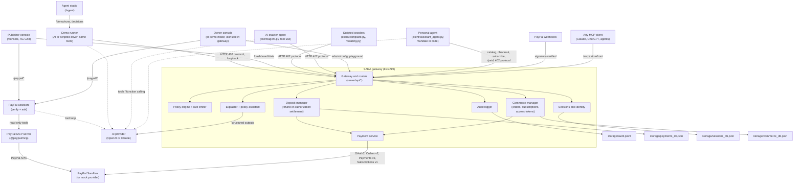
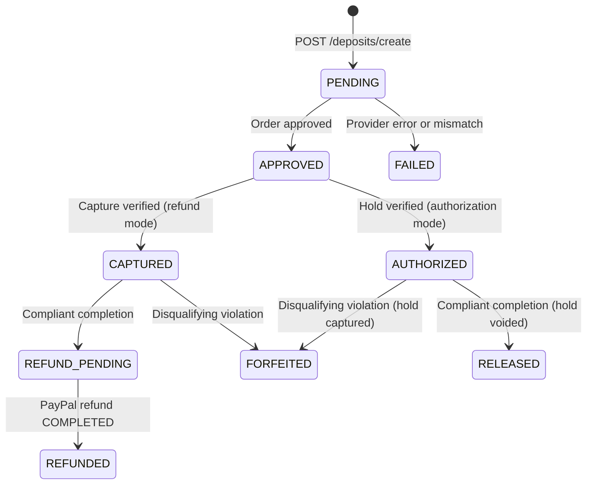
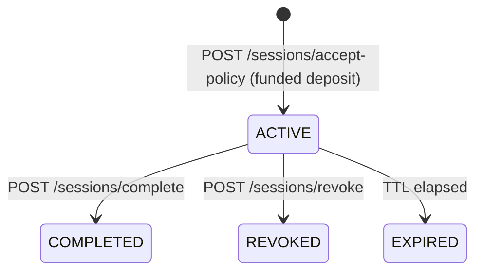

# SARA reference

The technical reference for SARA: configuration, API, architecture, state machines, policy
enforcement, security, tests, persistence, limitations, and example responses. The
[README](../README.md) explains what SARA does and how to try it.

## Configuration reference

Copy `.env.example` to `.env`. Settings are validated at startup (`server/config.py`).

| Variable | Default | Description |
| :--- | :--- | :--- |
| `APP_ENV` | `development` | `development`, `test`, or `production` (production requires `ADMIN_API_TOKEN`) |
| `APP_HOST` / `APP_PORT` | `127.0.0.1` / `8000` | Bind address for local runs |
| `APP_PUBLIC_URL` | `http://127.0.0.1:8000` | Public base URL for PayPal return/cancel callbacks; falls back to `RENDER_EXTERNAL_URL` |
| `SARA_MODE` | `demo` | `demo` (`/` is the owner console) or `gateway` (`/` proxies the owner site, console at `/console`) |
| `PAYMENT_MODE` | `mock` | `mock` (simulated) or `paypal_sandbox` |
| `DEPOSIT_SETTLEMENT` | `refund` | `refund` (capture, then refund compliant sessions) or `authorization` (hold, then void or capture) |
| `PAYPAL_BASE_URL` | `https://api-m.sandbox.paypal.com` | PayPal REST base URL |
| `PAYPAL_CLIENT_ID` / `PAYPAL_CLIENT_SECRET` | empty | Sandbox app credentials |
| `ORIGIN_URL` | empty | Target website for the transparent edge; can also be set live from the console |
| `ORIGIN_TIMEOUT_SECONDS` | `10` | Timeout for requests forwarded to the target website |
| `GATEWAY_CONFIG_PATH` | `storage/gateway_config.json` | Persisted multi-site registry (mount a volume in production) |
| `DEMO_CONFIG_PUBLIC` | `false` | Demo mode only: allow live config edits (including adding websites) without the admin token, with SSRF checks |
| `DEMO_ORIGIN_ALLOWLIST` | empty | Deprecated and unused: public origin changes are SSRF-checked instead of allowlisted |
| `CONFIG_MAX_WRITES_PER_HOUR` | `30` | Deprecated and unused: public config writes are no longer rate-limited |
| `DETECT_AGENT_USER_AGENTS` | `true` | Fail-closed User-Agent classification at the transparent edge: a recognised browser fingerprint passes as human, every other User-Agent counts as an agent |
| `PLAYGROUND_MAX_RUNS_PER_HOUR` | `20` | Hourly cap for agentic playground runs (starting also needs the admin token, `DEMO_PUBLIC=true`, or `DEMO_CONFIG_PUBLIC=true`) |
| `PLAYGROUND_MAX_ACTIONS` | `6` | Maximum actions in one playground checklist |
| `PLAYGROUND_AGENT_TIMEOUT_SECONDS` | `180` | Hard deadline for an agentic playground run |
| `PLAYGROUND_AGENT_MAX_TURNS` | `12` | Maximum model/tool turns in one playground run |
| `PAYPAL_CURRENCY` | `USD` | 3-letter ISO currency |
| `PAYPAL_TIMEOUT_SECONDS` | `15.0` | Timeout for PayPal calls |
| `PAYPAL_SANDBOX_AUTOPAY` | `false` | Sandbox only: pay deposits with PayPal's Sandbox test card (no buyer approval) |
| `PAYPAL_MCP_ENABLED` | `true` | PayPal assistant through PayPal's MCP server (uses the PayPal credentials) |
| `PAYPAL_MCP_TRANSPORT` | `local` | `local` (`@paypal/mcp` over stdio, Node.js 18+) or `hosted` (PayPal's remote server over SSE) |
| `PAYPAL_MCP_COMMAND` | `npx -y @paypal/mcp@1.8.1` | Command that starts the local server; the Docker image sets it to the bundled copy. Read-only `--tools` are always appended |
| `PAYPAL_MCP_URL` | `https://mcp.sandbox.paypal.com/sse` | Hosted server URL |
| `PAYPAL_MCP_TIMEOUT_SECONDS` | `60` | Timeout per MCP operation |
| `TIER1_PRICE` | `20.00` | Premium tier deposit (positive decimal; empty = value in `data/site_config.json`) |
| `TIER2_PRICE` | `10.00` | Standard tier deposit |
| `TIER3_PRICE` | `5.00` | Public tier deposit |
| `DEPOSIT_AMOUNT` | `1.00` | Base deposit for paths outside every pricing tier (on the bundled demo site, the site root `/`); `/news` is Public-tier content |
| `SESSION_TTL_SECONDS` / `CHALLENGE_TTL_SECONDS` | `1800` / `600` | Session and challenge lifetimes |
| `MAX_REQUESTS_PER_SESSION` | `10` | Allowed content requests per session |
| `RATE_LIMIT_REQUESTS` / `RATE_LIMIT_WINDOW_SECONDS` | `3` / `10` | Sliding-window rate limit |
| `AUDIT_LOG_PATH`, `PAYMENTS_DB_PATH`, `SESSIONS_DB_PATH` | `storage/...` | Persistence files |
| `PAYPAL_WEBHOOK_ID` | empty | Webhook ID from the PayPal app's webhook settings; without it, Sandbox webhooks are rejected (mock mode accepts simulated events signed `mock-webhook-signature`) |
| `COMMERCE_CATALOG_PATH` | `data/commerce_catalog.json` | Pay-per-access items, subscription plans, members pages, products, and downloads |
| `COMMERCE_DB_PATH` | `storage/commerce_db.json` | Orders, subscriptions, access-token hashes, and cached PayPal plan IDs |
| `ADMIN_API_TOKEN` | empty | Secret for `X-Admin-Token` (global audit, admin console, policy assistant, reconciliation). Generated per process when owner sign-in is on and this is empty |
| `OWNER_EMAIL` / `OWNER_PASSWORD` | empty | Owner sign-in. When both are set, `/` shows the home page, `/console` needs a signed-in owner, and the owner has the admin token's rights |
| `SESSION_SECRET` | generated per process | Signs the owner session cookie; set it so sign-ins survive restarts |
| `OWNER_SESSION_HOURS` | `12` | Owner session lifetime |
| `SEED_DEFAULT_SITE` | `true` | `true` starts a fresh gateway with the bundled demo website; `false` starts empty and the owner adds their first website in the console |
| `PAYPAL_MERCHANT_EMAIL` | empty | Payout account shown in the console until the first order or a Log in with PayPal connection names it |
| `DASHBOARD_PUBLIC` | `false` (`true` in `.env.example`) | Read-only console without the admin token, for demos; keep `false` in production |
| `DEMO_PUBLIC` | `false` (`true` in `.env.example`) | Anyone may start agent-studio runs and ask the read-only PayPal assistant, within the hourly caps; also opens public playground runs |
| `DEMO_MAX_RUNS_PER_HOUR` / `DEMO_MAX_QUESTIONS_PER_HOUR` | `20` / `30` | Caps for demo runs (all callers) and public PayPal assistant requests |
| `AI_PROVIDER` | `auto` | `openai`, `anthropic`, or `auto` (Claude if Anthropic credentials resolve, otherwise OpenAI if `OPENAI_API_KEY` is set) |
| `OPENAI_API_KEY` | unset | OpenAI credentials |
| `ANTHROPIC_API_KEY` | unset | Claude credentials (the SDK also accepts `ANTHROPIC_AUTH_TOKEN` or a profile) |
| `AI_ENABLED` | `true` | Turn AI features off entirely |
| `AI_MODEL` | empty | Model override; empty means `gpt-5.5` on OpenAI and `claude-opus-5-5` on Claude |
| `AI_EFFORT` | `medium` | `low`, `medium`, `high`, `xhigh`, or `max` (OpenAI maps `xhigh`/`max` to `high`) |
| `AI_REFUSAL_FALLBACK` | `true` | Claude only: server-side refusal fallback |
| `AI_TIMEOUT_SECONDS` | `120` | Timeout for AI calls |
| `LOG_LEVEL` | `INFO` | Python logging level |

## API reference

Interactive docs: **`/docs`** (Swagger UI) and **`/redoc`**.

| Method | Path | Auth | Purpose |
| :--- | :--- | :--- | :--- |
| GET | `/gateway`, `/gateway/{path}` | none (402) or crawler bearer | Protected content |
| GET | `/policies`, `/robots.txt`, `/health` | none | Machine-readable policy, robots rules, health and AI status |
| POST | `/policies/draft` | admin | Policy assistant (AI) |
| POST | `/deposits/create` | challenge proof | Create a deposit and PayPal order (`pay_with: paypal` skips the Sandbox test card so a person approves) |
| POST | `/deposits/{id}/capture`, `/deposits/{id}/verify` | owner | Capture (or authorize) and verify |
| GET | `/deposits/paypal/return`, `/deposits/paypal/cancel` | order match | PayPal browser callbacks |
| GET | `/deposits/{id}` | owner or admin | Deposit status |
| GET | `/deposits/{id}/explanation` | owner or admin | Evidence-cited explanation (`?use_ai=false` for rule-based) |
| POST | `/deposits/{id}/refund` | owner or admin | Evaluate and settle |
| POST | `/deposits/{id}/reconcile-refund` | admin | Reconcile a pending PayPal refund |
| POST | `/sessions/accept-policy` | deposit proof | Accept the policy and get a bearer token |
| GET | `/sessions/me` | crawler bearer | Session counters and violations |
| POST | `/sessions/complete`, `/sessions/revoke` | crawler bearer (revoke: admin too) | End the session and settle |
| GET | `/audit/events`, `/audit/summary` | crawler bearer (own session) or admin | Audit log |
| GET | `/.well-known/agent-commerce.json`, `/commerce/offers` | none | Offer catalog for agents: deposit tiers, pay-per-access, subscriptions, products, endpoints |
| POST | `/commerce/checkout` | agent ID | Create an itemized PayPal order for an access item or a product cart (the site sets the price) |
| POST | `/commerce/orders/{id}/capture`, `/commerce/orders/{id}/cancel` | owning agent | Capture and verify with PayPal (returns the access token once); cancel an unpaid order |
| GET | `/commerce/orders/{id}` | owning agent (`X-Agent-Id`) | Order status |
| POST | `/commerce/subscriptions` | agent ID | Start a PayPal subscription to a plan |
| POST | `/commerce/subscriptions/{ref}/activate`, `/commerce/subscriptions/{ref}/cancel` | owning agent | Confirm ACTIVE at PayPal (returns the token once); cancel at PayPal |
| GET | `/paid/{path}` | access token, or 402 with offers | Paid media, members pages, and downloads |
| GET | `/commerce/summary` | admin, or public when `DASHBOARD_PUBLIC=true` | Revenue by payment type, orders, subscriptions |
| GET | `/` | none | Home page (signed out) or owner console (signed in) in demo mode; proxied owner site in gateway mode |
| GET | `/signin` | none | Home page with the sign-in dialog; signed-in owners go to the console |
| GET | `/auth/me` | none | Whether sign-in is on and who is signed in |
| POST | `/auth/login`, `/auth/logout` | none (rate limited) | Owner sign-in with `OWNER_EMAIL`/`OWNER_PASSWORD` (sets an HttpOnly signed cookie), and sign-out |
| GET | `/paypal/account` | admin or signed-in owner | Payout account: PayPal connection, settlement mode, the account connected with Log in with PayPal, and the merchant account |
| POST | `/paypal/connect/start`, `/paypal/connect/disconnect` | admin or signed-in owner | Start Log in with PayPal (returns PayPal's sign-in URL), or disconnect |
| GET | `/paypal/connect/callback` | single-use state | PayPal's return after Log in with PayPal; saves the connection and returns to the console |
| GET | `/agent` | none | Earlier agent-side page (personal agent and crawler scenarios); not linked from the console |
| GET | `/crawler`, `/demo` | none | Earlier crawler deposit page; not linked from the console |
| GET | `/admin/config` | admin, or public when `DEMO_CONFIG_PUBLIC=true` in demo mode | Selected website's target URL, tier deposits, rules, and origin status |
| PUT | `/admin/config` | admin, or public when `DEMO_CONFIG_PUBLIC=true` in demo mode | Apply the selected website's target URL, tier deposit, and rule changes live |
| POST | `/admin/config/test-origin` | admin, or public when `DEMO_CONFIG_PUBLIC=true` in demo mode | Check that a target website is reachable and read its `robots.txt` |
| GET/POST | `/admin/sites` | same as `/admin/config` | List websites, or add one |
| PUT/DELETE | `/admin/sites/{site_id}` | same as `/admin/config` | Rename, pause/resume, or remove a website |
| POST | `/admin/sites/{site_id}/activate` | same as `/admin/config` | Select the website the console edits and plays |
| POST | `/admin/config/sync-robots` | admin | Re-import the target's `robots.txt` and apply it |
| GET | `/playground/actions`, `/playground/runs`, `/playground/runs/{run_id}` | admin; public when `DEMO_PUBLIC=true` or `DASHBOARD_PUBLIC=true` | Action checklist, agent availability, recent runs, and one run's live steps and per-action results |
| POST | `/playground/runs`, `/playground/runs/{run_id}/cancel` | admin, or public when `DEMO_PUBLIC=true` | Run the selected action checklist with the agent, or stop it; every run is audited |
| POST | `/webhooks/paypal` | PayPal signature | Verified PayPal webhook receiver |
| POST | `/commerce/orders/{id}/refund`, `/commerce/orders/{id}/tracking` | admin | Refund through PayPal; add shipment tracking |
| POST | `/paypal/orders/{id}/verify` | admin, or public demo | Compare a commerce order with PayPal's records through the MCP server |
| POST | `/mcp/` | none (wallet ID per shopper) | MCP storefront (Streamable HTTP) |
| POST | `/demo/runs/{id}/decision` | admin, or public demo | Approve or decline the purchase the personal agent is waiting on |
| GET | `/demo/config` | none (details need admin or a public demo) | Demo capabilities, run quota, active and recent runs |
| POST | `/demo/runs` | admin, or public when `DEMO_PUBLIC=true` | Start a run (`driver`: `ai` or `scripted`; `persona`: `compliant`, `rogue`, `goal` with `goal`, `site_id`, and `pay_with` (`paypal` waits for a person to approve at PayPal), or `assistant` with `task`, `budget`, `approval_threshold`, `allowed_types`; `goal` and `assistant` are AI-only). The console's playground uses `goal` |
| GET | `/demo/runs/{id}?after=N` | admin, or public demo or dashboard | Run status, deposit, explanation, and events from sequence `N` |
| POST | `/demo/runs/{id}/approval`, `/demo/runs/{id}/cancel` | admin, or public demo | Continue after PayPal approval; stop a run |
| GET | `/paypal/assistant/status` | admin, or public demo | MCP and AI configuration |
| POST | `/paypal/deposits/{id}/verify` | admin, or public demo | Compare a deposit with PayPal's records through the MCP server |
| POST | `/paypal/assistant/ask` | admin, or public demo (capped) | AI PayPal assistant over read-only MCP tools |
| GET | `/console`, `/dashboard` | signed-in owner when sign-in is on | Owner console (redirects to `/signin` otherwise) |
| GET | `/dashboard/data`, `/dashboard/deposits/{id}/explanation` | admin, or public when `DASHBOARD_PUBLIC=true` | Console data; `/dashboard/data?site=<id>` limits it to one website (default: every current website) |

## Architecture



| Component | Files | Responsibility |
| :--- | :--- | :--- |
| Gateway | `server/api/gateway.py` | Issues 402 challenges and serves content only when the policy engine allows it |
| Transparent edge | `server/api/site.py`, `server/services/origin_proxy.py` | Detects agents at the site root, forwards human traffic to the origin, and serves the owner console at `/` in demo mode |
| Policy engine | `server/services/policy_engine.py`, `rate_limiter.py` | Pure, payment-independent checks returning structured decisions |
| Identity and sessions | `server/core/identity.py`, `sessions.py`, `security.py` | Challenges, hashed bearer tokens, path normalization, violation counters |
| Deposit manager | `server/services/deposit_manager.py` | Orthogonal payment / decision / refund state machines, both settlement modes, reconciliation |
| Payment service | `server/services/payment_service.py` | `PayPalSandboxProvider` and `MockPaymentProvider` behind one interface |
| AI | `server/services/ai_client.py`, `explainer.py`, `policy_assistant.py` | OpenAI and Claude client wrappers, provider selection, explanations, policy drafts |
| Owner console | `server/api/dashboard.py`, `server/api/admin.py`, `server/services/runtime_config.py`, `server/static/dashboard.*` | Publisher console, live target/deposit/rule configuration, and the playground controls |
| Crawler playground | `server/api/playground.py`, `server/services/playground.py`, `server/services/playground_agent.py` | Agentic good/bad action checklist against the real gateway, per-action sessions/results, live steps, and audit entries |
| Demo runner | `server/api/demo.py`, `server/services/demo_runner.py`, `client/scripted_agent.py`, `server/static/demo.*` | Agent-studio runs: starts AI or scripted crawler runs in a background thread and records their events |
| PayPal assistant | `server/api/paypal.py`, `server/services/paypal_mcp.py`, `paypal_assistant.py`, `server/static/paypal_panel.js` | MCP client limited to read tools, deposit verification, AI questions |
| Agent commerce | `server/api/commerce.py`, `server/services/commerce.py`, `data/commerce_catalog.json` | Offer catalog, site-priced checkout, PayPal capture and subscriptions, hashed access tokens, paid content with 402 offers, publisher summary |
| Agent studio | `server/static/agent.*`, `server/services/demo_runner.py` | Runs the personal agent in the browser with live approvals, purchase reviews, the mandate ledger, and PayPal JS SDK buttons for people |
| MCP storefront | `server/services/storefront_mcp.py` | The site's offers as MCP tools, calling the site's own API in-process |
| Webhooks | `server/api/webhooks.py` | Signature-verified, idempotent PayPal events reconciled against PayPal |
| Audit logger | `server/services/audit_logger.py` | Append-only JSONL events with secret scrubbing |
| Crawlers | `client/agent.py`, `agent_tools.py`, `compliant.py`, `violating.py`, `common.py` | AI agent and scripted demo clients |
| Personal agent | `client/assistant_agent.py`, `assistant_tools.py`, `purchase_critic.py` | Multi-tool AI agent, spending mandate, AI purchase review, approvals |

The end-to-end request sequence is also available as an exportable diagram in [`docs/lifecycle_diagram.html`](lifecycle_diagram.html).

## Deposit and session state machines

SARA keeps **payment status**, **policy decision**, and **refund status** separate, so a policy violation is never confused with a money movement and a failed provider call never overwrites a confirmed payment.

- **`payment_status`:** `PENDING` → `APPROVED` → `CAPTURED` (refund mode) or `AUTHORIZED` → `VOIDED` / `CAPTURED` (authorization mode); `FAILED` on order, capture, or verification errors.
- **`policy_decision`:** `UNDECIDED` → `ELIGIBLE_FOR_REFUND` or `FORFEITED_BY_POLICY`. The decision is recorded before any provider call and never changes afterwards.
- **`refund_status`:** `NOT_REQUESTED` → `REFUND_IN_PROGRESS` → `REFUNDED` / `REFUND_PENDING` / `REFUND_FAILED`, or `NOT_APPLICABLE_FORFEITED` / `NOT_APPLICABLE_RELEASED`.
- **`deposit_state` (summary):** `PENDING`, `APPROVED`, `AUTHORIZED`, `CAPTURED`, `REFUND_PENDING`, `REFUNDED`, `RELEASED`, `FORFEITED`, `FAILED`.





Ambiguous provider outcomes (timeouts, 5xx, 409, unreadable responses) are kept pending and reconciled against PayPal's own records before anything is retried, so a refund, void, or capture is never issued twice.

## Policy enforcement logic

Every authenticated agent request — at the transparent edge, or on the legacy `/gateway/{path}` alias — is evaluated in this order:

| # | Condition | Reason code | HTTP | Violation | Disqualifying |
| :--- | :--- | :--- | :--- | :--- | :--- |
| 1 | Missing or unknown bearer token | `INVALID_SESSION` | 401 | No | No |
| 2 | Session revoked | `SESSION_REVOKED` | 401 | No | No |
| 3 | Session expired | `SESSION_EXPIRED` | 401 | No | No |
| 4 | Request after `/sessions/complete` | `SESSION_ALREADY_COMPLETED` | 403 | Yes | No |
| 5 | Deposit not funded (captured or authorized) or already forfeited | `DEPOSIT_NOT_ACTIVE` | 402 | No | No |
| 6 | Session policy version differs from the site's | `POLICY_VERSION_MISMATCH` | 403 | No | No |
| 7 | Path traversal (`..`, `%2e%2e`, `%2f`, `\`, null byte) | `INVALID_PATH` | 403 | Yes | Yes |
| 8 | Path matches `disallowed_paths` (most specific rule wins) | `DISALLOWED_PATH` | 403 | Yes | Yes |
| 9 | Sliding window exceeded (default 3 requests / 10 s) | `RATE_LIMIT_EXCEEDED` | 429 | Yes | Yes, from the 2nd violation |
| 10 | Session budget exceeded (default 10 allowed requests) | `MAX_REQUESTS_EXCEEDED` | 429 | Yes | Yes |
| 11 | Path not a known page | `UNKNOWN_PATH` | 404 | No | No |
| 12 | Allowed path within all limits | `ALLOWED` | 200 | No | No |

Longer (more specific) rules beat broader ones, with `disallowed_paths` winning ties; `/` matches only the home page. Rejected requests are logged with the path exactly as the crawler sent it (for example `/%2e%2e/admin`).

## Security and AI safety

- Bearer tokens come from `secrets.token_urlsafe(32)`, are stored only as SHA-256 hashes, and are compared in constant time.
- Deposit amounts are set by the server and verified with PayPal; clients cannot self-certify payment.
- The gateway inspects the raw ASGI path, so encoded and double-encoded traversal is caught before any content lookup; disallowed page bodies are never loaded into the serving map.
- Audit logs scrub tokens and secrets; the dashboard feed omits event details because they can contain PayPal checkout URLs; all dashboard text from crawlers is rendered as text, never HTML.
- AI-specific safeguards are listed in the [README](../README.md#where-the-ai-is): the model never decides money movements, page content is marked untrusted, the bearer token is never sent to the model, spending is capped in code, and AI cost is bounded.
- PayPal MCP: only five read tools can be called (the local server is started with only those enabled, and the client rejects any other name); the OAuth token goes to the MCP server process, never to the model; the server process gets a minimal environment without AI keys; PayPal results are redacted of email addresses before they are shown or sent to a model, and reach the model inside `<paypal_mcp_result>` tags as data.
- Agent commerce: the site prices every order from its catalog (requests carrying a price are rejected), verifies capture or subscription status with PayPal before granting anything, issues one token per purchase (returned once, stored hashed) that unlocks only what was bought, and keeps orders private to the agent that placed them.
- Spending mandate: payment type, remaining budget, and the approval threshold are checked by the agent's toolbox before money moves; recurring charges always need the person's approval; a declined order is cancelled; tokens never reach the model.
- Webhooks: every event is verified with PayPal before anything happens, processed once by event ID, and handled by re-reading PayPal: a capture or refund event alone never changes an order. Refunds end access at once.
- MCP storefront: tokens and the crawl bearer token stay in a server-side wallet; the assistant only holds a random wallet ID; every call goes through the same API, prices, and PayPal checks as other clients.
- Public demos: one run at a time, hourly caps on runs and assistant requests, a 25-turn limit, a deposit limit per run equal to the highest tier price, and runs that stop waiting for PayPal approval after 10 minutes.

## Testing

```bash
pytest -q
```

The suite (404 tests) needs no network access or credentials; PayPal, OpenAI, Claude, and the PayPal MCP server are replaced by mocked transports and scripted fakes.

| File | Covers |
| :--- | :--- |
| `test_gateway.py`, `test_policy_engine.py`, `test_rate_limiter.py` | 402 challenges, path rules, traversal vectors, rate limits, budgets |
| `test_violation_reporting.py` | Attempted paths in violation records; no duplicate disqualification reasons |
| `test_deposits.py`, `test_audit.py` | Challenge reuse, ownership, idempotent completion, audit scoping and scrubbing |
| `test_payments.py` | PayPal Sandbox provider: OAuth, orders, callbacks, refunds, reconciliation, recovery |
| `test_authorization_settlement.py` | Authorization holds: release, forfeiture, retries, and the PayPal authorize/void/capture paths |
| `test_ai_features.py` | Explainer citations and fallbacks, cost guard, policy assistant validation, Claude request shape and error mapping |
| `test_openai_provider.py` | OpenAI request shape, refusal and truncation handling, error mapping, provider selection and model defaults |
| `test_agent.py`, `test_agent_openai.py` | AI agent on both providers against the real gateway with scripted models: refund, forfeiture, spending cap, refusal, token never sent to the model |
| `test_dashboard.py`, `test_compliant_cli.py` | Console data, access rules, KPIs; CLI output |
| `test_site_edge.py` | Transparent edge: agent detection (header, signature, User-Agent), human proxying with methods and cookies, reserved paths, and root behaviour in demo and gateway modes |
| `test_runtime_config.py` | Live config validation, persistence, policy version bumps, SSRF checks, and public write quotas |
| `test_playground.py`, `test_playground_agent.py` | Curated action outcomes, matched rules, deposit consequences, audit entries, and the hourly cap; guarded agent checklist, per-action sessions, early-stop completion, AI-unavailable gating, and audit events |
| `test_demo.py` | Demo page and assets; scripted and AI runs through the runner (refund and forfeiture); access, hourly cap, cancellation |
| `test_commerce.py` | Offer catalog, 402 offers, pay-per-access, product carts with shipping, site-set prices, subscriptions and cancellation, agent isolation, persistence, PayPal itemized-order and Subscriptions API request bodies |
| `test_assistant_agent.py` | Personal agent: strict tool schemas, mandate (budget, allowed types, threshold, recurring approval), declined orders cancelled, deposit refund back into the budget, and a full run through the demo runner with approve and decline |
| `test_webhooks.py` | Signature rejection, idempotency, capture confirmed against PayPal (not the event body), lazy token issue, refunds ending access, disputes, subscription sync and renewals, publisher refund and tracking, Sandbox signature verification request |
| `test_storefront_mcp.py` | The official MCP client over Streamable HTTP against a real server: discover, quote, pay, open content, subscribe, compliant and violating crawls, wallet isolation |
| `test_owner_auth.py` | Owner sign-in: home page for signed-out visitors, console redirect, wrong passwords, rate limiting, cookie tampering and expiry, cross-site writes refused |
| `test_paypal_login.py` | Log in with PayPal: authorize URL, single-use state, code exchange, OpenID and PayPal userinfo with fallbacks, a confirmed login kept while PayPal withholds the profile, disconnect |
| `test_multi_site.py` | Multiple websites: routing by Host, header, and path; per-site config, sessions, and playground; starting with no website; per-website dashboard counts; duplicate and redirecting websites |
| `test_origin_proxy.py` | Origin proxy: robots.txt import, forwarding, redirects, the owner console cookie never reaching the website, and same-site redirect resolution |
| `test_paypal_assistant.py` | MCP read-only allowlist, server command and environment, error handling, email redaction, deposit verification (refund, hold, mismatch), AI tool loops on both providers, API access and quotas |

## Persistence and troubleshooting

- Payments, sessions, and commerce state are kept in `storage/payments_db.json`, `storage/sessions_db.json`, and `storage/commerce_db.json` (written atomically with `fsync` and `os.replace`) and `storage/audit.jsonl` (append-only). The live owner configuration is `storage/gateway_config.json` (`GATEWAY_CONFIG_PATH`), written atomically on every **Apply live**. Expired sessions are marked on startup; corrupted files stop startup with `PersistenceCorruptionError` rather than silently resetting.
- In one container, mount `/app/storage` on a named volume (or bind mount). That keeps the gateway configuration, deposits, sessions, commerce, and audit log across container replacements and redeploys.
- Run a **single** server process: state and rate limits are held in that process.

| Symptom | Cause | Fix |
| :--- | :--- | :--- |
| `409 payer_approval_required` on capture | Sandbox buyer has not approved the order | Open the `approval_url`, approve with the Sandbox buyer account, retry |
| `502` on `/deposits/create` | Sandbox mode without valid PayPal credentials | Set `PAYPAL_CLIENT_ID` / `PAYPAL_CLIENT_SECRET`, or use `PAYMENT_MODE=mock` |
| `/console` sends you to sign-in | Owner sign-in is on (`OWNER_EMAIL`/`OWNER_PASSWORD`) | Sign in with those credentials on the home page |
| Log in with PayPal shows "invalid client_id or redirect_uri" | Log in with PayPal is off for the app, or the return URL is not registered | In the Developer Dashboard, enable Log in with PayPal and add `<APP_PUBLIC_URL>/paypal/connect/callback` as a return URL (it can take up to three hours to apply) |
| PayPal connected but no email shown | PayPal has not released the profile yet | Connect again later; the connection is kept meanwhile |
| Explanations say "rule-based" | No AI credentials on the server | Set `OPENAI_API_KEY` (or `ANTHROPIC_API_KEY`) and restart |
| `/policies/draft` returns 503 | Same as above | Same as above |
| Agent exits with "No AI credentials found" | No key in the agent's environment or `.env` | Set `OPENAI_API_KEY` (or `ANTHROPIC_API_KEY`) |
| OpenAI calls fail with a model error | `AI_MODEL` names a model your account cannot use | Leave `AI_MODEL` empty or pick a model listed for your key |
| `PersistenceCorruptionError` on startup | A file in `storage/` was edited into invalid JSON | Fix or delete it and restart |
| PayPal assistant: "Node.js was not found" | Local MCP transport without Node.js | Install Node.js 18+, use the Docker image, or set `PAYPAL_MCP_TRANSPORT=hosted` |
| PayPal assistant: `list_transactions` returns HTTP 403 | Transaction search is not enabled for the PayPal app | Enable it in the Developer Dashboard (it can take a few hours to apply) |
| Demo "Start run" is disabled | `DEMO_PUBLIC` is off, or a run is in progress | Enter the admin token in Agent studio, or wait for the run to finish |

## Limitations and roadmap

**Known limitations**

- Unsigned agents are identified only by their paid session: a determined operator can start over with a new unsigned identity and a new deposit (it always pays the full price). Verified identity depends on the site's own key directory; fetching keys from agents' published directories (`Signature-Agent`) is not built yet.
- The transparent edge is a reverse proxy, not a CDN edge worker or CMS plugin: it buffers response bodies up to a size limit, does not cache, and re-imports the origin's `robots.txt` on startup and whenever the target or rules change. Reserved SARA paths (`/console`, `/admin`, `/health`, `/_sara/static/*`, and the API prefixes listed above) cannot be proxied to the origin.
- JSON persistence and in-memory rate limits support a single process only.
- Saving a payment method was run live with PayPal's test card. Saving a PayPal wallet (the production path, where the person approves the first payment at PayPal) uses the same order fields but reads the vault token from the capture, and is covered by mocked-transport tests only; PayPal's standalone vault setup tokens are not enabled for our Sandbox app.
- The buyer-approval checkout path has been run against the live Sandbox up to the approval step (the demo shows the real checkout URL); completing it needs a Sandbox buyer login, so the capture after approval is covered by mocked-transport tests.
- PayPal's hosted MCP server failed every tool call in testing (2026-11-05); the bundled local server is used instead.
- AI agent behaviour depends on the model; the scripted crawlers give deterministic results for rehearsals. The Claude path, and the PayPal assistant's AI question path, have not been run against a live model in this version (the assistant's tool execution was run against the live MCP server with a scripted stand-in model).

- Subscriptions in the Sandbox need a payer to approve the subscription at PayPal (there is no test-card shortcut as there is for deposits); in mock mode they activate at once. The Subscriptions API calls are covered by mocked-transport tests and have not yet been run against the live Sandbox.
- Shipping is a flat rate per physical product line; tracking is added by the publisher by hand.
- Webhooks, shipment tracking, commerce-order verification, and the JS SDK v6 buttons are covered by mocked-transport tests and run in mock mode; they have not yet been run against the live Sandbox (that needs a public URL for webhooks and a Sandbox buyer login for the buttons).
- The MCP storefront has no buyer login: whoever holds a wallet ID can use what that wallet bought. Payments are Sandbox or mock only.

**Roadmap**

1. PayPal Agent Ready as the agent's payment method, alongside saved PayPal wallets.
2. Mandates issued and verified by PayPal (budget, merchant allow-list, approval rules) instead of the agent's own toolbox, so merchants can trust them.
4. Optional pay-per-page fee captured from the hold, so publishers also earn from good crawlers.
5. PostgreSQL and Redis for multi-instance deployments.
6. Agent keys fetched from each agent's published key directory (`Signature-Agent`), and records shared between sites.
7. A CDN edge worker and CMS plugins on top of reverse-proxy mode.

## Example API responses

**402 challenge** (`GET /gateway/news` without a token):

```json
{
  "error": "payment_required",
  "challenge_id": "chg_9c4e7f1b8a204d3c9f0123456789abcd",
  "crawler_id": "crawler-demo-01",
  "site_id": "demo-news-site",
  "policy_version": "1.0",
  "deposit": { "amount": "5.00", "currency": "USD", "refundable": true },
  "pricing": { "tier_id": "public", "tier_name": "Public", "price": "5.00", "currency": "USD", "resource": "/news" },
  "rules_summary": {
    "allowed_paths": ["/", "/news", "/news/technology", "/news/economy"],
    "disallowed_paths": ["/admin", "/private/customer-data", "/internal/reports"],
    "max_requests_per_session": 10,
    "rate_limit_requests": 3,
    "rate_limit_window_seconds": 10.0,
    "session_ttl_seconds": 1800
  },
  "policy_url": "/policies",
  "payment_url": "/deposits/create",
  "session_url": "/sessions/accept-policy",
  "expires_at": "2026-10-29T06:15:00+00:00",
  "notice": "Payment alone does not grant unrestricted access. You must verify the deposit, explicitly accept the current crawling policy version, and comply with all path and rate-limit rules to remain eligible for a deposit refund.",
  "message": "Complete the deposit and accept the crawling policy."
}
```

**Disallowed path** (`GET /gateway/admin`, HTTP 403):

```json
{
  "error": "disallowed_path",
  "allowed": false,
  "reason_code": "DISALLOWED_PATH",
  "reason": "Access to path '/admin' is prohibited by crawling policy.",
  "violation": true,
  "disqualifying": true,
  "session_disqualified": true,
  "policy_version": "1.0",
  "path": "/admin",
  "remaining_session_budget": 9,
  "remaining_window_requests": 2,
  "retry_after_seconds": 0.0
}
```

**Rate limit** (HTTP 429, with a `Retry-After` header):

```json
{
  "error": "rate_limit_exceeded",
  "allowed": false,
  "reason_code": "RATE_LIMIT_EXCEEDED",
  "reason": "Rate limit of 3 requests per 10s window exceeded.",
  "violation": true,
  "disqualifying": true,
  "session_disqualified": true,
  "policy_version": "1.0",
  "path": "/news/technology",
  "remaining_session_budget": 7,
  "remaining_window_requests": 0,
  "retry_after_seconds": 8.42
}
```

---

Licensed under the MIT License. The original CrawlerPal concept document is archived in [`docs/history/`](history/crawler_pal_arch.md).
