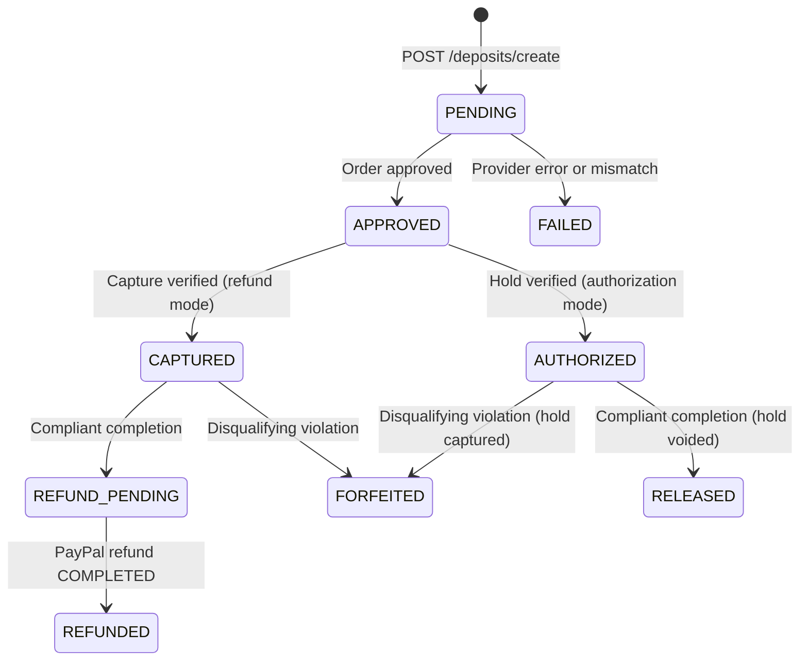
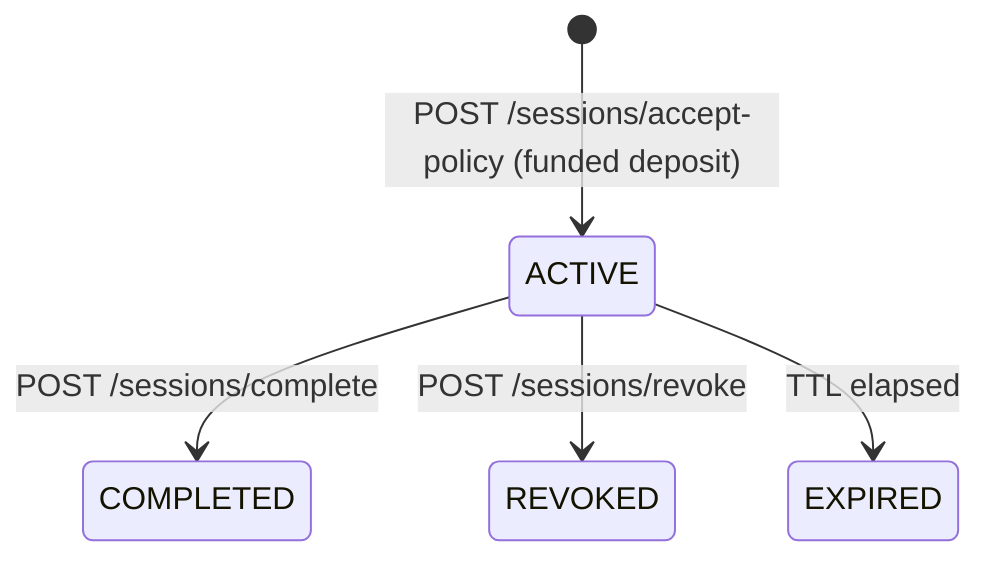

# SARA reference

Reference material for running and integrating SARA. The overview, the evidence, and the demo are in the [README](../README.md).

## Contents

- [Configuration](#configuration)
- [API reference](#api-reference)
- [Components](#components)
- [Deposit and session state machines](#deposit-and-session-state-machines)
- [Policy enforcement logic](#policy-enforcement-logic)
- [Tests](#tests)
- [Persistence and troubleshooting](#persistence-and-troubleshooting)
- [Example API responses](#example-api-responses)


## Configuration

Copy `.env.example` to `.env`. Settings are validated at startup (`server/config.py`).

| Variable | Default | Description |
| :--- | :--- | :--- |
| `APP_ENV` | `development` | `development`, `test`, or `production` (production requires `ADMIN_API_TOKEN`) |
| `APP_HOST` / `APP_PORT` | `127.0.0.1` / `8000` | Bind address for local runs |
| `APP_PUBLIC_URL` | `http://127.0.0.1:8000` | Public base URL for PayPal return/cancel callbacks; falls back to `RENDER_EXTERNAL_URL` |
| `PAYMENT_MODE` | `mock` | `mock` (simulated) or `paypal_sandbox` |
| `DEPOSIT_SETTLEMENT` | `refund` | `refund` (capture, then refund compliant sessions) or `authorization` (hold, then void or capture) |
| `PAYPAL_BASE_URL` | `https://api-m.sandbox.paypal.com` | PayPal REST base URL |
| `PAYPAL_CLIENT_ID` / `PAYPAL_CLIENT_SECRET` | empty | Sandbox app credentials |
| `PAYPAL_CURRENCY` | `USD` | 3-letter ISO currency |
| `PAYPAL_TIMEOUT_SECONDS` | `15.0` | Timeout for PayPal calls |
| `PAYPAL_SANDBOX_AUTOPAY` | `false` | Sandbox only: pay deposits with PayPal's Sandbox test card (no buyer approval) |
| `PAYPAL_MCP_ENABLED` | `true` | PayPal assistant through PayPal's MCP server (uses the PayPal credentials) |
| `PAYPAL_MCP_TRANSPORT` | `local` | `local` (`@paypal/mcp` over stdio, Node.js 18+) or `hosted` (PayPal's remote server over SSE) |
| `PAYPAL_MCP_COMMAND` | `npx -y @paypal/mcp@1.8.1` | Command that starts the local server; the Docker image sets it to the bundled copy. Read-only `--tools` are always appended |
| `PAYPAL_MCP_URL` | `https://mcp.sandbox.paypal.com/sse` | Hosted server URL |
| `PAYPAL_MCP_TIMEOUT_SECONDS` | `60` | Timeout per MCP operation |
| `TIER1_PRICE` | `20.00` | Premium tier deposit (positive decimal; empty = value in `data/site_config.json`) |
| `TIER2_PRICE` | `10.00` | Standard tier deposit |
| `TIER3_PRICE` | `5.00` | Public tier deposit |
| `DEPOSIT_AMOUNT` | `1.00` | Base deposit for paths outside every pricing tier (the home page `/`); `/news` is Public-tier content |
| `SESSION_TTL_SECONDS` / `CHALLENGE_TTL_SECONDS` | `1800` / `600` | Session and challenge lifetimes |
| `MAX_REQUESTS_PER_SESSION` | `10` | Allowed content requests per session |
| `RATE_LIMIT_REQUESTS` / `RATE_LIMIT_WINDOW_SECONDS` | `3` / `10` | Sliding-window rate limit |
| `AUDIT_LOG_PATH`, `PAYMENTS_DB_PATH`, `SESSIONS_DB_PATH` | `storage/...` | Persistence files |
| `PAYPAL_WEBHOOK_ID` | empty | Webhook ID from the PayPal app's webhook settings; without it, Sandbox webhooks are rejected (mock mode accepts simulated events signed `mock-webhook-signature`) |
| `COMMERCE_CATALOG_PATH` | `data/commerce_catalog.json` | Pay-per-access items, subscription plans, members pages, products, and downloads |
| `COMMERCE_DB_PATH` | `storage/commerce_db.json` | Orders, subscriptions, access-token hashes, and cached PayPal plan IDs |
| `ADMIN_API_TOKEN` | empty | Secret for `X-Admin-Token` (global audit, admin console, policy assistant, reconciliation) |
| `DASHBOARD_PUBLIC` | `false` (`true` in `.env.example`) | Read-only console without the admin token, for demos; keep `false` in production |
| `DEMO_PUBLIC` | `false` (`true` in `.env.example`) | Anyone may start demo runs and ask the read-only PayPal assistant, within the hourly caps |
| `DEMO_MAX_RUNS_PER_HOUR` / `DEMO_MAX_QUESTIONS_PER_HOUR` | `20` / `30` | Caps for demo runs (all callers) and public PayPal assistant requests |
| `AI_PROVIDER` | `auto` | `openai`, `anthropic`, or `auto` (Claude if Anthropic credentials resolve, otherwise OpenAI if `OPENAI_API_KEY` is set) |
| `OPENAI_API_KEY` | unset | OpenAI credentials |
| `ANTHROPIC_API_KEY` | unset | Claude credentials (the SDK also accepts `ANTHROPIC_AUTH_TOKEN` or a profile) |
| `AI_ENABLED` | `true` | Turn AI features off entirely |
| `AI_MODEL` | empty | Model override; empty means `gpt-5.5` on OpenAI and `claude-opus-5-5` on Claude |
| `AI_EFFORT` | `medium` | `low`, `medium`, `high`, `xhigh`, or `max` (OpenAI maps `xhigh`/`max` to `high`) |
| `AI_REFUSAL_FALLBACK` | `true` | Claude only: server-side refusal fallback |
| `AI_TIMEOUT_SECONDS` | `120` | Timeout for AI calls |
| `LOG_LEVEL` | `INFO` | Python logging level |

## API reference

Interactive docs: **`/docs`** (Swagger UI) and **`/redoc`**.

| Method | Path | Auth | Purpose |
| :--- | :--- | :--- | :--- |
| GET | `/gateway`, `/gateway/{path}` | none (402) or crawler bearer | Protected content |
| GET | `/policies`, `/robots.txt`, `/health` | none | Machine-readable policy, robots rules, health and AI status |
| POST | `/policies/draft` | admin | Policy assistant (AI) |
| POST | `/deposits/create` | challenge proof | Create a deposit and PayPal order |
| POST | `/deposits/{id}/capture`, `/deposits/{id}/verify` | owner | Capture (or authorize) and verify |
| GET | `/deposits/paypal/return`, `/deposits/paypal/cancel` | order match | PayPal browser callbacks |
| GET | `/deposits/{id}` | owner or admin | Deposit status |
| GET | `/deposits/{id}/explanation` | owner or admin | Evidence-cited explanation (`?use_ai=false` for rule-based) |
| POST | `/deposits/{id}/refund` | owner or admin | Evaluate and settle |
| POST | `/deposits/{id}/reconcile-refund` | admin | Reconcile a pending PayPal refund |
| POST | `/sessions/accept-policy` | deposit proof | Accept the policy and get a bearer token |
| GET | `/sessions/me` | crawler bearer | Session counters and violations |
| POST | `/sessions/complete`, `/sessions/revoke` | crawler bearer (revoke: admin too) | End the session and settle |
| GET | `/audit/events`, `/audit/summary` | crawler bearer (own session) or admin | Audit log |
| GET | `/.well-known/agent-commerce.json`, `/commerce/offers` | none | Offer catalog for agents: deposit tiers, pay-per-access, subscriptions, products, endpoints |
| POST | `/commerce/checkout` | agent ID | Create an itemized PayPal order for an access item or a product cart (the site sets the price) |
| POST | `/commerce/orders/{id}/capture`, `/commerce/orders/{id}/cancel` | owning agent | Capture and verify with PayPal (returns the access token once); cancel an unpaid order |
| GET | `/commerce/orders/{id}` | owning agent (`X-Agent-Id`) | Order status |
| POST | `/commerce/subscriptions` | agent ID | Start a PayPal subscription to a plan |
| POST | `/commerce/subscriptions/{ref}/activate`, `/commerce/subscriptions/{ref}/cancel` | owning agent | Confirm ACTIVE at PayPal (returns the token once); cancel at PayPal |
| GET | `/paid/{path}` | access token, or 402 with offers | Paid media, members pages, and downloads |
| GET | `/commerce/summary` | admin, or public when `DASHBOARD_PUBLIC=true` | Revenue by payment type, orders, subscriptions |
| GET | `/`, `/agent` | none | Agent tab (landing page) |
| GET | `/website` | none | Website tab: Sentinel News for people |
| GET | `/website/content` | none | The website's article text (visible text only) for the Website tab |
| GET | `/about` | none | About this demo |
| GET | `/crawler`, `/demo` | none | Older crawler deposit page (kept for the video recorder; not linked) |
| POST | `/webhooks/paypal` | PayPal signature | Verified PayPal webhook receiver |
| POST | `/commerce/orders/{id}/refund`, `/commerce/orders/{id}/tracking` | admin | Refund through PayPal; add shipment tracking |
| POST | `/paypal/orders/{id}/verify` | admin, or public demo | Compare a commerce order with PayPal's records through the MCP server |
| POST | `/mcp/` | none (wallet ID per shopper) | MCP storefront (Streamable HTTP) |
| POST | `/demo/runs/{id}/decision` | admin, or public demo | Approve or decline the purchase the personal agent is waiting on |
| GET | `/demo/config` | none (details need admin or a public demo) | Demo capabilities, run quota, active and recent runs |
| POST | `/demo/runs` | admin, or public when `DEMO_PUBLIC=true` | Start a run (`driver`: `ai` or `scripted`; `persona`: `compliant`, `rogue`, or `assistant` with `task`, `budget`, `approval_threshold`, `allowed_types`; the assistant is AI-only) |
| GET | `/demo/runs/{id}?after=N` | admin, or public demo or dashboard | Run status, deposit, explanation, and events from sequence `N` |
| POST | `/demo/runs/{id}/approval`, `/demo/runs/{id}/cancel` | admin, or public demo | Continue after PayPal approval; stop a run |
| GET | `/paypal/assistant/status` | admin, or public demo | MCP and AI configuration |
| POST | `/paypal/deposits/{id}/verify` | admin, or public demo | Compare a deposit with PayPal's records through the MCP server |
| POST | `/paypal/assistant/ask` | admin, or public demo (capped) | AI PayPal assistant over read-only MCP tools |
| GET | `/console`, `/dashboard` | none | Owner dashboard |
| GET | `/dashboard/data`, `/dashboard/deposits/{id}/explanation` | admin, or public when `DASHBOARD_PUBLIC=true` | Console data |

## Components

| Component | Files | Responsibility |
| :--- | :--- | :--- |
| Gateway | `server/api/gateway.py` | Issues 402 challenges and serves content only when the policy engine allows it |
| Policy engine | `server/services/policy_engine.py`, `rate_limiter.py` | Pure, payment-independent checks returning structured decisions |
| Identity and sessions | `server/core/identity.py`, `sessions.py`, `security.py` | Challenges, hashed bearer tokens, path normalization, violation counters |
| Deposit manager | `server/services/deposit_manager.py` | Orthogonal payment / decision / refund state machines, both settlement modes, reconciliation |
| Payment service | `server/services/payment_service.py` | `PayPalSandboxProvider` and `MockPaymentProvider` behind one interface |
| AI | `server/services/ai_client.py`, `explainer.py`, `policy_assistant.py` | OpenAI and Claude client wrappers, provider selection, explanations, policy drafts |
| Dashboard | `server/api/dashboard.py`, `server/static/dashboard.*` | Owner dashboard and its data endpoints |
| Live demo | `server/api/demo.py`, `server/services/demo_runner.py`, `client/scripted_agent.py`, `server/static/demo.*` | Browser demo: starts AI or scripted crawler runs in a background thread and records their events |
| PayPal assistant | `server/api/paypal.py`, `server/services/paypal_mcp.py`, `paypal_assistant.py`, `server/static/paypal_panel.js` | MCP client limited to read tools, deposit verification, AI questions |
| Agent commerce | `server/api/commerce.py`, `server/services/commerce.py`, `data/commerce_catalog.json` | Offer catalog, site-priced checkout, PayPal capture and subscriptions, hashed access tokens, paid content with 402 offers, publisher summary |
| Agent tab | `server/static/agent.*`, `server/services/demo_runner.py` | Runs the personal agent in the browser with live approvals, purchase reviews, and the mandate ledger |
| Website and About tabs | `server/static/site.*`, `server/static/about.html`, `server/static/pages.css`, `server/static/shell.js` | Sentinel News for people, with PayPal JS SDK buttons, and the demo overview |
| MCP storefront | `server/services/storefront_mcp.py` | The site's offers as MCP tools, calling the site's own API in-process |
| Webhooks | `server/api/webhooks.py` | Signature-verified, idempotent PayPal events reconciled against PayPal |
| Audit logger | `server/services/audit_logger.py` | Append-only JSONL events with secret scrubbing |
| Crawlers | `client/agent.py`, `agent_tools.py`, `compliant.py`, `violating.py`, `common.py` | AI agent and scripted demo clients |
| Personal agent | `client/assistant_agent.py`, `assistant_tools.py`, `purchase_critic.py` | Multi-tool AI agent, spending mandate, AI purchase review, approvals |

The end-to-end request sequence is also available as an exportable diagram in [`docs/lifecycle_diagram.html`](lifecycle_diagram.html).

## Deposit and session state machines

SARA keeps **payment status**, **policy decision**, and **refund status** separate, so a policy violation is never confused with a money movement and a failed provider call never overwrites a confirmed payment.

- **`payment_status`:** `PENDING` → `APPROVED` → `CAPTURED` (refund mode) or `AUTHORIZED` → `VOIDED` / `CAPTURED` (authorization mode); `FAILED` on order, capture, or verification errors.
- **`policy_decision`:** `UNDECIDED` → `ELIGIBLE_FOR_REFUND` or `FORFEITED_BY_POLICY`. The decision is recorded before any provider call and never changes afterwards.
- **`refund_status`:** `NOT_REQUESTED` → `REFUND_IN_PROGRESS` → `REFUNDED` / `REFUND_PENDING` / `REFUND_FAILED`, or `NOT_APPLICABLE_FORFEITED` / `NOT_APPLICABLE_RELEASED`.
- **`deposit_state` (summary):** `PENDING`, `APPROVED`, `AUTHORIZED`, `CAPTURED`, `REFUND_PENDING`, `REFUNDED`, `RELEASED`, `FORFEITED`, `FAILED`.





Ambiguous provider outcomes (timeouts, 5xx, 409, unreadable responses) are kept pending and reconciled against PayPal's own records before anything is retried, so a refund, void, or capture is never issued twice.

## Policy enforcement logic

Every authenticated request to `/gateway/{path}` is evaluated in this order:

| # | Condition | Reason code | HTTP | Violation | Disqualifying |
| :--- | :--- | :--- | :--- | :--- | :--- |
| 1 | Missing or unknown bearer token | `INVALID_SESSION` | 401 | No | No |
| 2 | Session revoked | `SESSION_REVOKED` | 401 | No | No |
| 3 | Session expired | `SESSION_EXPIRED` | 401 | No | No |
| 4 | Request after `/sessions/complete` | `SESSION_ALREADY_COMPLETED` | 403 | Yes | No |
| 5 | Deposit not funded (captured or authorized) or already forfeited | `DEPOSIT_NOT_ACTIVE` | 402 | No | No |
| 6 | Session policy version differs from the site's | `POLICY_VERSION_MISMATCH` | 403 | No | No |
| 7 | Path traversal (`..`, `%2e%2e`, `%2f`, `\`, null byte) | `INVALID_PATH` | 403 | Yes | Yes |
| 8 | Path matches `disallowed_paths` (most specific rule wins) | `DISALLOWED_PATH` | 403 | Yes | Yes |
| 9 | Sliding window exceeded (default 3 requests / 10 s) | `RATE_LIMIT_EXCEEDED` | 429 | Yes | Yes, from the 2nd violation |
| 10 | Session budget exceeded (default 10 allowed requests) | `MAX_REQUESTS_EXCEEDED` | 429 | Yes | Yes |
| 11 | Path not a known page | `UNKNOWN_PATH` | 404 | No | No |
| 12 | Allowed path within all limits | `ALLOWED` | 200 | No | No |

Longer (more specific) rules beat broader ones, with `disallowed_paths` winning ties; `/` matches only the home page. Rejected requests are logged with the path exactly as the crawler sent it (for example `/%2e%2e/admin`).

## Tests

| File | Covers |
| :--- | :--- |
| `test_gateway.py`, `test_policy_engine.py`, `test_rate_limiter.py` | 402 challenges, path rules, traversal vectors, rate limits, budgets |
| `test_violation_reporting.py` | Attempted paths in violation records; no duplicate disqualification reasons |
| `test_deposits.py`, `test_audit.py` | Challenge reuse, ownership, idempotent completion, audit scoping and scrubbing |
| `test_payments.py` | PayPal Sandbox provider: OAuth, orders, callbacks, refunds, reconciliation, recovery |
| `test_authorization_settlement.py` | Authorization holds: release, forfeiture, retries, and the PayPal authorize/void/capture paths |
| `test_ai_features.py` | Explainer citations and fallbacks, cost guard, policy assistant validation, Claude request shape and error mapping |
| `test_openai_provider.py` | OpenAI request shape, refusal and truncation handling, error mapping, provider selection and model defaults |
| `test_agent.py`, `test_agent_openai.py` | AI agent on both providers against the real gateway with scripted models: refund, forfeiture, spending cap, refusal, token never sent to the model |
| `test_dashboard.py`, `test_compliant_cli.py` | Console data, access rules, KPIs; CLI output |
| `test_demo.py` | Demo page and assets; scripted and AI runs through the runner (refund and forfeiture); access, hourly cap, cancellation |
| `test_commerce.py` | Offer catalog, 402 offers, pay-per-access, product carts with shipping, site-set prices, subscriptions and cancellation, agent isolation, persistence, PayPal itemized-order and Subscriptions API request bodies |
| `test_assistant_agent.py` | Personal agent: strict tool schemas, mandate (budget, allowed types, threshold, recurring approval), declined orders cancelled, deposit refund back into the budget, and a full run through the demo runner with approve and decline |
| `test_webhooks.py` | Signature rejection, idempotency, capture confirmed against PayPal (not the event body), lazy token issue, refunds ending access, disputes, subscription sync and renewals, publisher refund and tracking, Sandbox signature verification request |
| `test_storefront_mcp.py` | The official MCP client over Streamable HTTP against a real server: discover, quote, pay, open content, subscribe, compliant and violating crawls, wallet isolation |
| `test_paypal_assistant.py` | MCP read-only allowlist, server command and environment, error handling, email redaction, deposit verification (refund, hold, mismatch), AI tool loops on both providers, API access and quotas |

## Persistence and troubleshooting

- State is kept in `storage/payments_db.json` and `storage/sessions_db.json` (written atomically with `fsync` and `os.replace`) and `storage/audit.jsonl` (append-only). Expired sessions are marked on startup; corrupted files stop startup with `PersistenceCorruptionError` rather than silently resetting.
- Run a **single** server process: state and rate limits are held in that process.

| Symptom | Cause | Fix |
| :--- | :--- | :--- |
| `409 payer_approval_required` on capture | Sandbox buyer has not approved the order | Open the `approval_url`, approve with the Sandbox buyer account, retry |
| `502` on `/deposits/create` | Sandbox mode without valid PayPal credentials | Set `PAYPAL_CLIENT_ID` / `PAYPAL_CLIENT_SECRET`, or use `PAYMENT_MODE=mock` |
| Console shows "Enter the admin token" | `DASHBOARD_PUBLIC` is off | Enter `ADMIN_API_TOKEN` in the console, or set `DASHBOARD_PUBLIC=true` for a demo |
| Explanations say "rule-based" | No AI credentials on the server | Set `OPENAI_API_KEY` (or `ANTHROPIC_API_KEY`) and restart |
| `/policies/draft` returns 503 | Same as above | Same as above |
| Agent exits with "No AI credentials found" | No key in the agent's environment or `.env` | Set `OPENAI_API_KEY` (or `ANTHROPIC_API_KEY`) |
| OpenAI calls fail with a model error | `AI_MODEL` names a model your account cannot use | Leave `AI_MODEL` empty or pick a model listed for your key |
| `PersistenceCorruptionError` on startup | A file in `storage/` was edited into invalid JSON | Fix or delete it and restart |
| PayPal assistant: "Node.js was not found" | Local MCP transport without Node.js | Install Node.js 18+, use the Docker image, or set `PAYPAL_MCP_TRANSPORT=hosted` |
| PayPal assistant: `list_transactions` returns HTTP 403 | Transaction search is not enabled for the PayPal app | Enable it in the Developer Dashboard (it can take a few hours to apply) |
| Demo "Start run" is disabled | `DEMO_PUBLIC` is off, or a run is in progress | Enter the admin token on the demo page, or wait for the run to finish |

## Example API responses

**402 challenge** (`GET /gateway/news` without a token):

```json
{
  "error": "payment_required",
  "challenge_id": "chg_9c4e7f1b8a204d3c9f0123456789abcd",
  "crawler_id": "crawler-demo-01",
  "site_id": "demo-news-site",
  "policy_version": "1.0",
  "deposit": { "amount": "5.00", "currency": "USD", "refundable": true },
  "pricing": { "tier_id": "public", "tier_name": "Public", "price": "5.00", "currency": "USD", "resource": "/news" },
  "rules_summary": {
    "allowed_paths": ["/", "/news", "/news/technology", "/news/economy"],
    "disallowed_paths": ["/admin", "/private/customer-data", "/internal/reports"],
    "max_requests_per_session": 10,
    "rate_limit_requests": 3,
    "rate_limit_window_seconds": 10.0,
    "session_ttl_seconds": 1800
  },
  "policy_url": "/policies",
  "payment_url": "/deposits/create",
  "session_url": "/sessions/accept-policy",
  "expires_at": "2026-10-29T06:15:00+00:00",
  "notice": "Payment alone does not grant unrestricted access. You must verify the deposit, explicitly accept the current crawling policy version, and comply with all path and rate-limit rules to remain eligible for a deposit refund.",
  "message": "Complete the deposit and accept the crawling policy."
}
```

**Disallowed path** (`GET /gateway/admin`, HTTP 403):

```json
{
  "error": "disallowed_path",
  "allowed": false,
  "reason_code": "DISALLOWED_PATH",
  "reason": "Access to path '/admin' is prohibited by crawling policy.",
  "violation": true,
  "disqualifying": true,
  "session_disqualified": true,
  "policy_version": "1.0",
  "path": "/admin",
  "remaining_session_budget": 9,
  "remaining_window_requests": 2,
  "retry_after_seconds": 0.0
}
```

**Rate limit** (HTTP 429, with a `Retry-After` header):

```json
{
  "error": "rate_limit_exceeded",
  "allowed": false,
  "reason_code": "RATE_LIMIT_EXCEEDED",
  "reason": "Rate limit of 3 requests per 10s window exceeded.",
  "violation": true,
  "disqualifying": true,
  "session_disqualified": true,
  "policy_version": "1.0",
  "path": "/news/technology",
  "remaining_session_budget": 7,
  "remaining_window_requests": 0,
  "retry_after_seconds": 8.42
}
```
